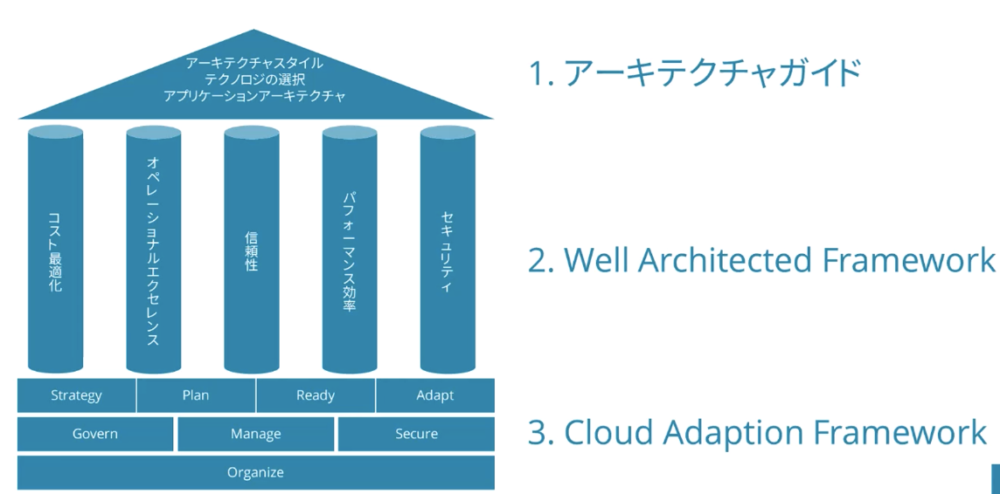
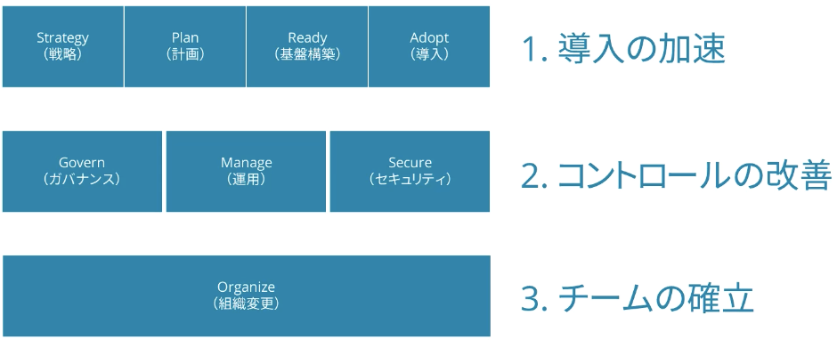

# Azure Solutions Architect Export (AZ-305)

## 出題範囲

1. ID、ガバナンス、および監視ソリューションを設計する（25-30%）
2. データストレージソリューションを設計する（20-25%）
3. ビジネス継続性ソリューションを設計する（15-20%）
4. インフラストラクチャソリューションを設計する（30-35%）

## アーキテクトのためのドキュメント入門

### 公式ドキュメント

https://learn.microsoft.com/ja-jp/

1. [アーキテクチャガイド](https://learn.microsoft.com/ja-jp/azure/architecture/guide/)
2. [Well Architected Framework](https://learn.microsoft.com/ja-jp/azure/well-architected/)
3. [Cloud Adoption Framework](https://learn.microsoft.com/ja-jp/azure/cloud-adoption-framework/overview)

## アーキテクチャガイド

1. アーキテクチャスタイル
2. テクノロジの選択
3. アプリケーションアーキテクチャ
4. Well Architected Framework (※1)

※1: アーキテクチャガイドの一部であり独立したドキュメント

### アーキテクチャスタイル

- N層
- マイクロサービス
- イベントドリブン
- Webキューワーカー
- ビッグコンピューティング
- ビッグデータ

### テクノロジの選択

- コンピューティングサービスの選択
- コンテナーオプションの選択
- ストレージサービスの選択
- データストアの選択
- メッセージングサービスの選択
- メッセージングサービスの選択

### アプリケーションアーキテクチャ

- レファレンスアーキテクチャ
- デザインパターン
- デザイン原則
- ベストプラクティス

## Well Architected Framework

1. ５つの柱
2. ワークロード
3. サービス
4. 関連ツール

### 5つの柱

1. コスト最適化
2. オペレーショナルエクセレンス
3. 信頼性
4. パフォーマンス効率
5. セキュリティ

#### コスト最適化

無駄な費用を削減し、運用効率を向上させること

- 予算の設定 | Azure Budgetの設定、コストパフォーマンスの検討
- コスト管理と監視 | Cost Managementの利用、Azure Monitorの設定
- リソースの選択 | Iaas・PaaS・SaaSの選択、クラウドネイティブアーキテクチャ、冗長化要件
- ワークロードの最適化 | Azure Advisor、スケーリング

#### オペレーショナルエクセレンス

運用および開発体験をよくすること

- プロセスの最適化 | CI/CDパイプライン、GitHub Actions、Azure DevOps、IaC
- 運用の正常性 | ビルド・リリースプロセスの監視・自動化、インフラ・アプリケーションの監視
- 疎結合アーキテクチャ | マイクロサービス、サーバレス

#### 信頼性

アプリケーションの回復性・可用性・耐障害性

- ビジネス要件 | SLA、コストとのトレードオフ
- 障害の想定 | Azure Site Recovery、可用性セット、ゾーン冗長
- 正常性の監視 | Application Insights、Azure Service Health
- 自動化 | 自動テスト、自動修復
- 水平スケーリング | トラフィックの急増、ユニットの障害

#### パフォーマンス効率

アプリの受容に合わせて、効果的な方法でワークロードを調整すること

- 水平スケーリング | PaaSの利用、ステートレス、キャッシュ
- 早期テスト | 負荷テスト、CIパイプラインでのパフォーマンステスト
- 継続的な監視 | ソリューション全体の監視、需要の再評価

※ 水平=サーバの台数を増やす、垂直=サーバの容量/サイズをふやす

#### セキュリティ

組織が利用、保存および送信するデータを保護すること

- 計画段階から考慮 | セキュア・バイ・デザインの原則
- 特権の最小化・自動化 | 最小権原の原則、DevSecOps
- データの分類と暗号化 | データの重要度、常に暗号化
- 潜在的な脅威の保護 | Azure Firewall、DDos Protection、コードレベルの脆弱性
- セキュリティの監視 | セキュリティイベントの監視、手順の自動化、Sentinel

#### 試験対策

1. 最適化は監視から
2. 水平スケーリング
3. 自動化

## Cloud Adoption Framework

クラウドを導入し、ビジネスの成果を達成するのに役立つ、実証済のガイダンスとベストプラクティスがまとめられたもの

1. 導入体験（概要）
2. ガイダンス
3. シナリオ
4. 関連リソース

### Cloud Adoption Frameworkの構成

1. 導入の加速（試験範囲はAdopt/クラウド移行のみ）
2. コントロールの改善
3. チームの確立
