# ガバナンス

## AZ-350出題範囲

| 出題領域                                           | 出題割合 | サブ領域                                      |
| -------------------------------------------------- | -------- | --------------------------------------------- |
| ID、ガバナンス、および監視ソリューションを設計する | 25-30%   | 1. ガバナンス設計                             |
|                                                    |          | 2. 認証と認可のソリューションを設計する       |
|                                                    |          | 3. アプリケーションのIDとアクセスを設定する   |
|                                                    |          | 4. ログと監視のためのソリューションを設計する |
| データストレージソリューションを設計する           | 20-25%   | -                                             |
| ビジネス継続性ソリューションを設計する             | 15-20%   | -                                             |
| インフラストラクチャソリューションを設計する       | 30-35%   | -                                             |

| 領域                                          | No  | 項目                                                                                       |
| --------------------------------------------- | --- | ------------------------------------------------------------------------------------------ |
| 1. ガバナンス設計                             | 1   | Azureリソースの組織と階層の構造を推奨する                                                  |
|                                               | 2   | コンプライアンスの適用および監査するためのソリューションを推奨する                         |
| 2. 認証と認可のソリューションを設計する       | 1   | ロールベースのアクセス制御でリソースをセキュリティ保護するためのソリューションを推奨する   |
|                                               | 2   | ID管理ソリューションを推奨する                                                             |
|                                               | 3   | IDをセキュリティ保護するためのソリューションを推奨する                                     |
| 3. アプリケーションのIDとアクセスを設定する   | 1   | アプリケーションからAzureリソースにアクセスできるソリューションを推奨する                  |
|                                               | 2   | パスワードとシークレットを安全に格納するソリューションを推奨する                           |
|                                               | 3   | アプリケーションをMicrosoft Entra ID（旧Azure AD）に統合するためのソリューションを推奨する |
|                                               | 4   | アプリケーションのユーザー同意ソリューションを推奨する                                     |
| 4. ログと監視のためのソリューションを設計する | 1   | ログルーティングソリューションを設計する                                                   |
|                                               | 2   | 適切なレベルのログ記録を推奨する                                                           |
|                                               | 3   | ソリューションの監視ツールを推奨する                                                       |

## ID、ガバナンス、および監視ソリューションを設計する

1. ガバナンスの全体像
2. Azureリソースの構造
3. ガバナンス設計
4. ランディングゾーン

## ガバナンスの全体像

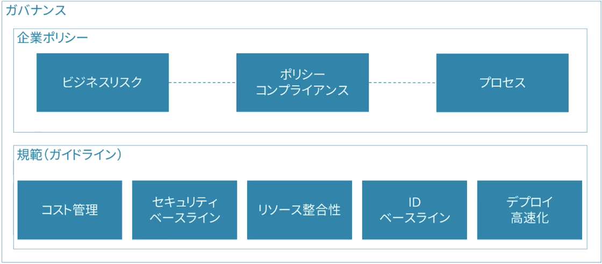

## Azureリソース構造

4階層になっており、各階層ごとに適切なガバナンスを検討・設計する

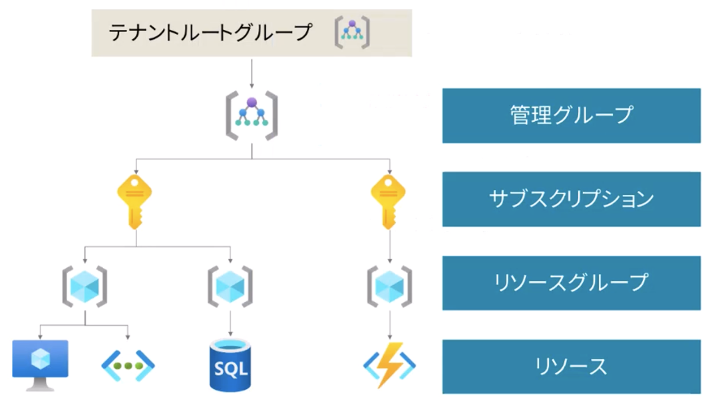

### 管理グループ | Resource Mamanger

複数のサブスクリプションに対して、アクセス権・ポリシー・コンプライアンスを管理

- 入れ子構造を作ることができる
- IDは役割でつけ、組織名は入れない
- アクセス権やポリシーを変更する境界を定義するために設計する

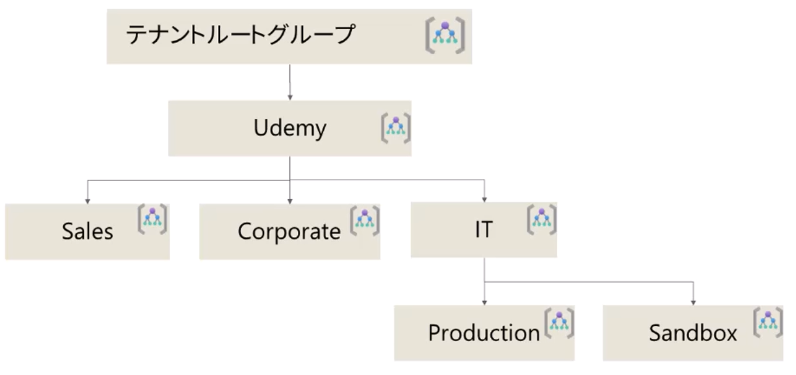

命名例（CAF / Azure Landing Zones の構成に合わせた場合）

| ID                    | 表示名         | 用途                                         |
| --------------------- | -------------- | -------------------------------------------- |
| dws                   | DWS            | 中間のルート。Tenant Root Group の直下に置く |
| dws-platform          | Platform       | 共通基盤                                     |
| dws-management        | Management     | ログ、監視                                   |
| dws-connectivity      | Connectivity   | ネットワークのハブ                           |
| dws-identity          | Identity       | ID 基盤                                      |
| dws-landingzones      | Landing Zones  | 業務ワークロード                             |
| dws-corp / dws-online | Corp / Online  | 社内向け / インターネット公開                |
| dws-sandbox           | Sandbox        | 検証、PoC                                    |
| dws-decommissioned    | Decommissioned | 廃止予定のサブスクリプションの置き場         |

### サブスクリプション

コストと管理を論理的に分離する

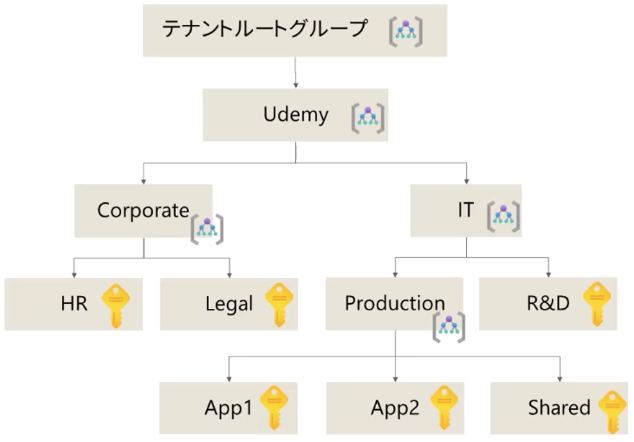

サブスクリプションの作成例

1. 課金やコスト算出の単位
2. 管理者の単位
3. 共通基盤
4. 環境種別（本番・開発・テスト）
5. ワークロード（アプリ）の単位
6. リソース上限の回避

### リソースグループ

関連するAzureリソースをまとめる論理コンテナ

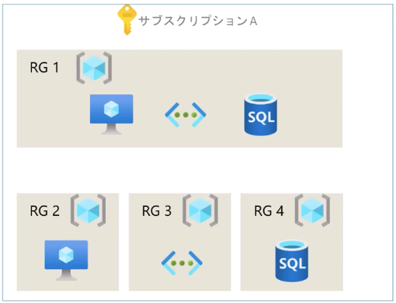

1. ライフサイクル別
2. アクセス権の単位
3. 環境種別（本番・開発・テスト）
4. ワークロード（アプリ）の単位

### タグ

ビジネス・IT要件のためのメタデータ付与

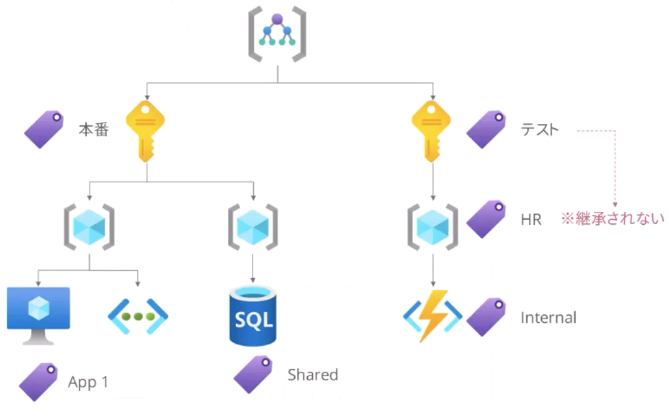

タグは継承されない | サブスク内のすべてのリソースにタグ付けする場合はポリシーで設定する

1. コスト管理
2. 監視
3. 管理者・所有者の明確化
4. 環境種別（本番・開発・テスト）
5. ワークロード（アプリ）の明確化

## 1.ガバナンス設計

Azure Policy

- 組織ポリシーの統制
- コンプライアンス評価

Azure RBAC

- Azureリソースへのアクセス権
- 操作権限の管理

### Azure Policy

組織ポリシーの強制、コンプライアンス評価

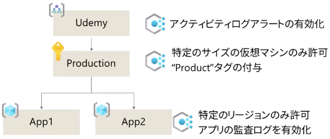

1. 特定のSKUのみ許可
2. タグ付けの強制
3. セキュリティパッチの適用
4. 多要素認証の有効化
5. パブリックネットワークアクセスの無効化
6. コンプライアンス設定

※ SKU(Stock Keeping Unit)：スペックやサービス内容と利用価格が紐付けられた機能グレード、プラン（価格レベル、Tier）

設計ポイント

1. 可能な限り上位スコープでポリシーを適用する
2. ポリシーが評価されるタイミングを理解する
   - リソースの作成・更新
   - 新規ポリシー割り当て
   - 24時間に1回
3. 準拠していないリソースに対するアクションを決める
   - 自動修復
   - ログに記録
   - 作成をブロック

### Azure RBAC (Role Base Access Control)

Azureリソースへのアクセス権・操作権限の管理

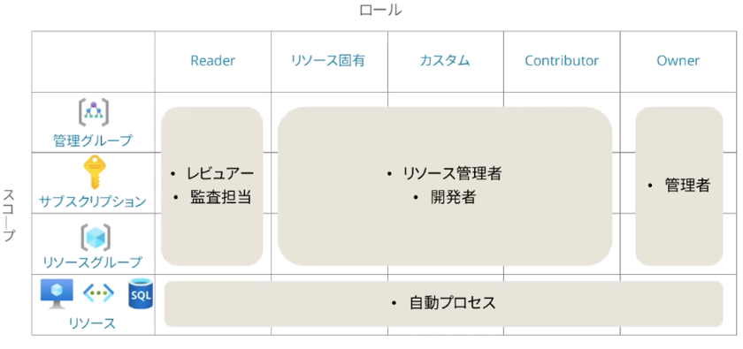

ベストプラクティス

1. 最小権原の原則（JEA）
2. Just In Timeアクセス（JIT）
3. グループへのロール割り当て

### Azure Policy/RBACの組み合わせ

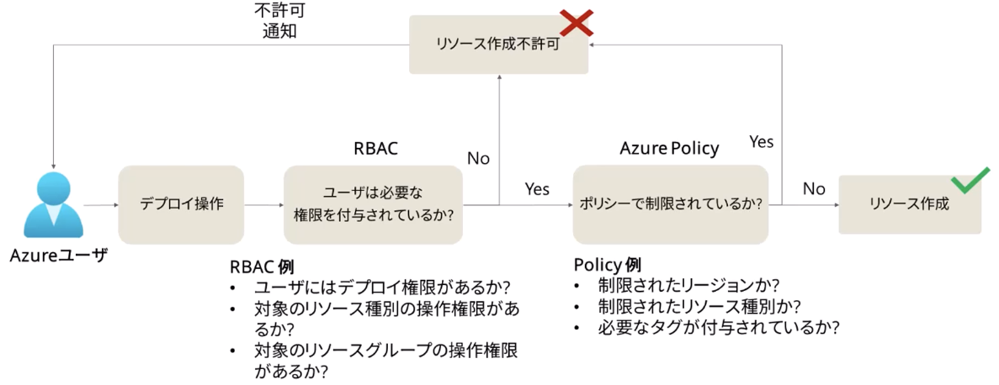

- RBAC | ユーザにリソースへのアクセス権や操作権限があるか
- Policy | リソースの整合性は保たれているか

### ランディングゾーン

Cloud Adaption Frameworkで定義されている共通基盤のレファレンスアーキテクチャ

[ランディングゾーン](https://learn.microsoft.com/ja-jp/azure/cloud-adoption-framework/ready/landing-zone/?tabs=conceptual%2Chubspoke)

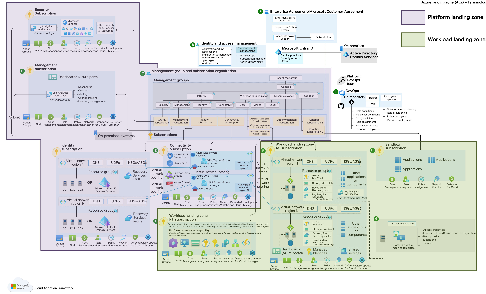

## 2.認証と認可のソリューションを設計する

1. IDとアクセス権の管理の全体像
2. Microsoft Entra IDの設計
3. 条件付きアクセスの設計
4. Identity Protectionの設計
5. アクセスレビューの設計

## IDとアクセス権の管理の全体像

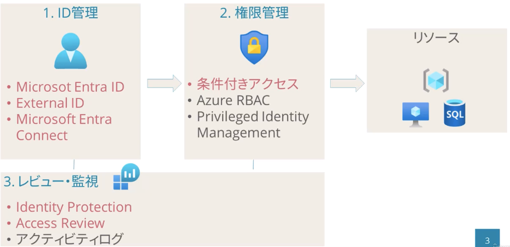

## Microsoft Entra IDの設計

### Microsoft Entra ID (Azure Active Directory)

クラウドベースのIDおよびアクセス管理サービス

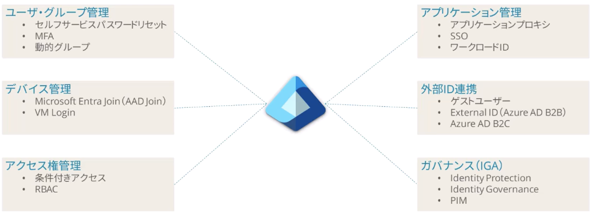

### ハイブリッドID

オンプレミスADとEntra IDの同期

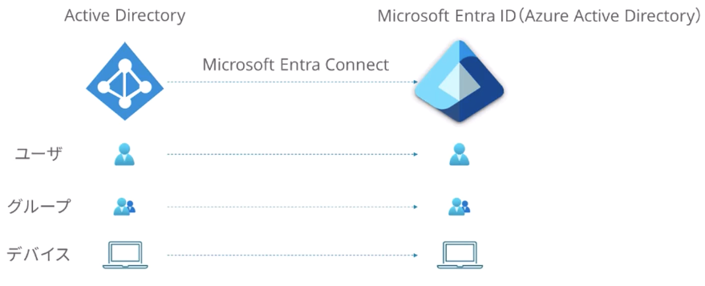

### Microsoft Entra External ID (Azure AD B2B)

外部テナントのユーザとのコラボレーション

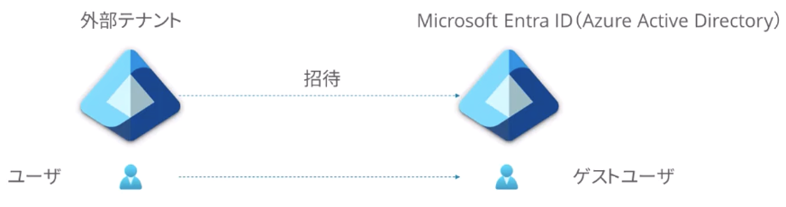

- 誰が招待するのか
- ゲストユーザにどこまで自社のポリシーを適用するのか（MFAなど）
- ゲストユーザのアクセス権管理をどうするのか | ACCESSVIEWの機能が使える

### まとめ

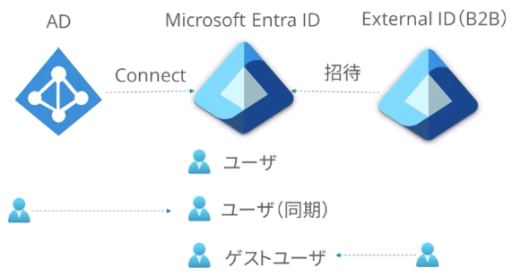

- オンプレID->Entra ID | 同期ユーザ
- External ID->Entra ID | ゲストユーザ

## 条件付きアクセス

リソースに対するアクセス許可（または拒否）を制御する機能

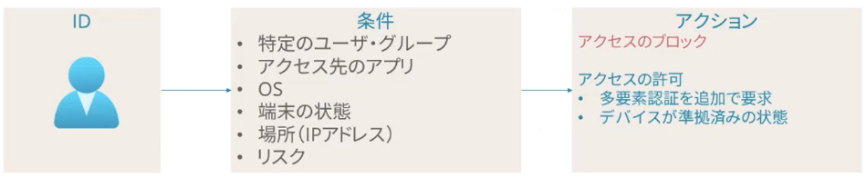

- アクセスするための条件とそれに対するアクションを設定する
- リスクある行動（複数回PW間違えるなど）をリアルタイムで評価できる

### ポリシー例）管理者に対してMFAを必須にする

条件

- 特定のユーザ・グループ
  - 管理者グループ
- アクセス先のクラウドアプリ
  - すべてのアプリ

アクション

- アクセスの許可
  - 多要素認証を追加で要求

### ポリシーの評価論理

複数のポリシーが設定されている場合、一番厳しい条件（AND条件）が適用される

- ポリシー1: HRグループ所属社員はアクセスを許可
- ポリシー2: 日本以外からのアクセスをブロック

ID（グループ:HR/アクセス元:海外）->アクセスをブロック

### ベストプラクティス

GoldenConfig -> [Zero Trust](https://learn.microsoft.com/ja-jp/security/zero-trust/zero-trust-identity-device-access-policies-overview) のドキュメントに移行

## Identity Protection

IDに関するリスクをリアルタイムで検出

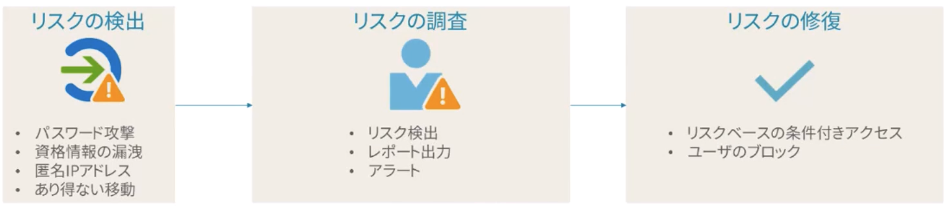

## アクセスレビュー

既存のアクセス権を評価し、継続してアクセスが必要化を確認する運用機能

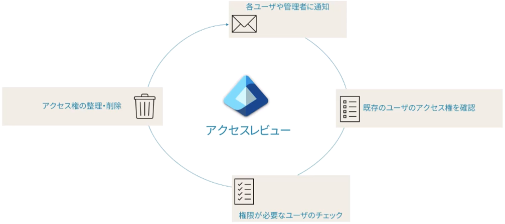

運用プロセスの見直しが必要

- どのリソースを対象にするのか
- 誰がレビューするのか
- 管理者はだれか
- セルフレビューしてよいのはどんなリソースか
- 棚卸し周期はどれくらいにするか

## 3.アプリケーションのIDとアクセスを設計する

1. マネージドIDの設計
2. サービスプリンシパルの設計
3. Azure Key Vaultの設計

## マネージドIDの設計

### "アンマネージド"ID

”資格情報”を利用したリソースのアクセス

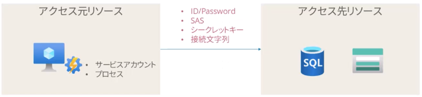

※SAS：Shared Access Signature

"資格情報"の管理が運用上の負担、セキュリティ上のリスクになる

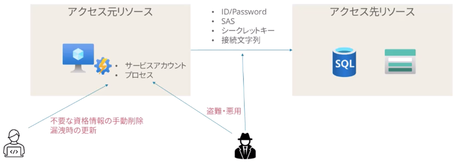

### マネージドID

"資格情報"を管理することなくアクセス

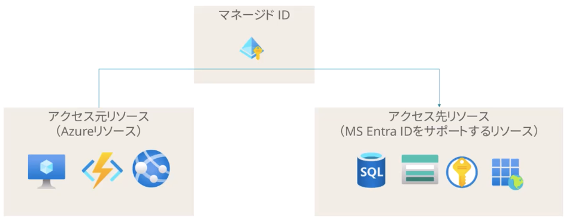

サポートされているAzureリソース->Entra IDをサポートするリソースへのアクセス管理から解放される

### マネージドIDの種別

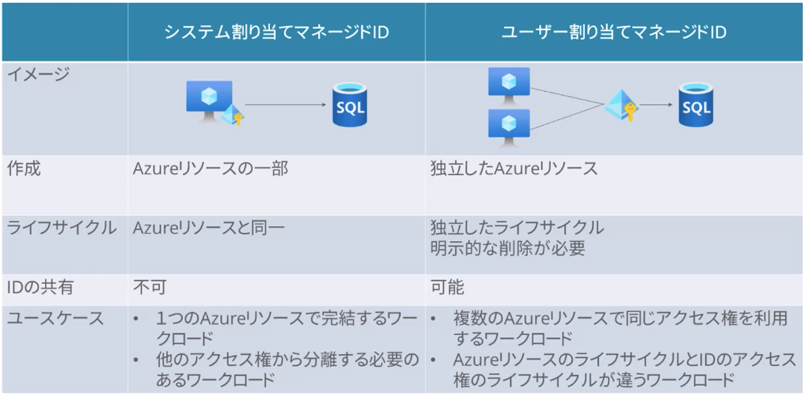

## サービスプリンシパルの設計

アプリケーションやサービスのためのID

- カスタムアプリ・SaaSをテナントにアプリケーションとして登録する
- 登録したアプリケーションに対してアービスプリンシパルを作成する
- サービスプリンシパルを経由してAzureリソースにアクセスできる
- マネージドIDが利用できないカスタムアプリの認証に使う

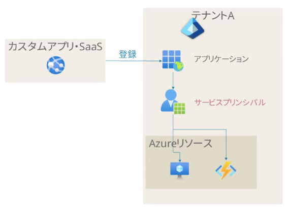

別のテナントに展開することもできる

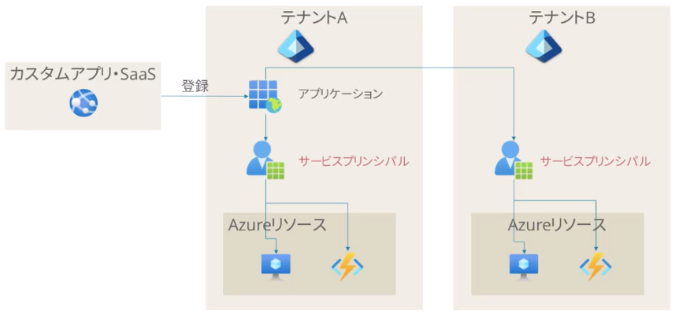

他のクラウドサービス・オンプレシステムにも利用できる

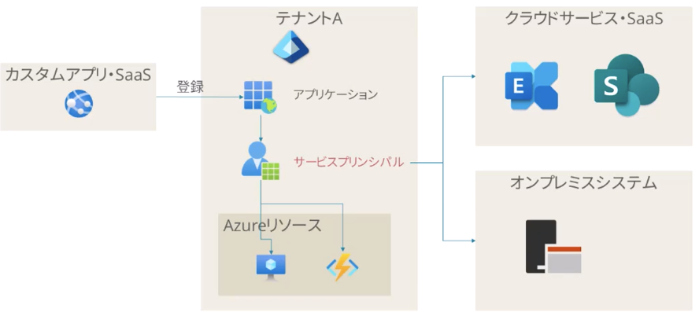

## Azure Key Valutの設計

サービスで利用する暗号化キーと秘密情報の保存先

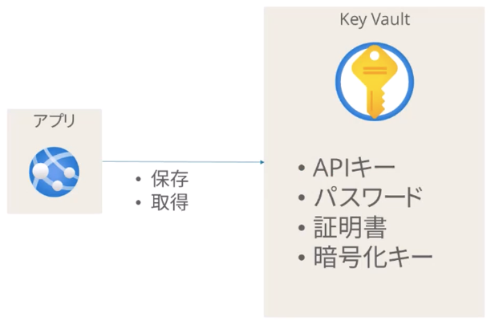

### Key Vaultでサポートされているオブジェクト

| オブジェクト            | 内容                                                      |
| ----------------------- | --------------------------------------------------------- |
| シークレット（secrets） | APIキー、パスワード、接続文字列、アプリのConfigファイル等 |
| キー（keys）            | ソフトウェア保護キー、HSMで保護されたキー                 |
| 証明書（certificates）  | X.509証明書                                               |

### Key Valutのプラクティス

マネージドIDを利用してアクセスする

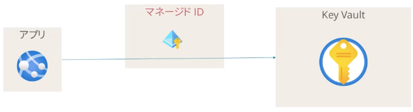
