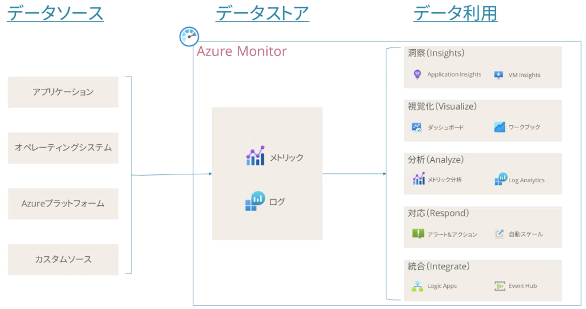
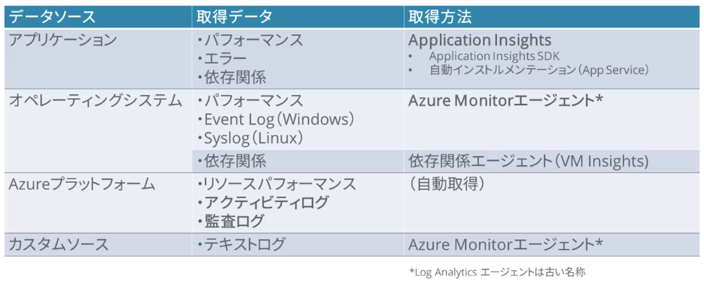
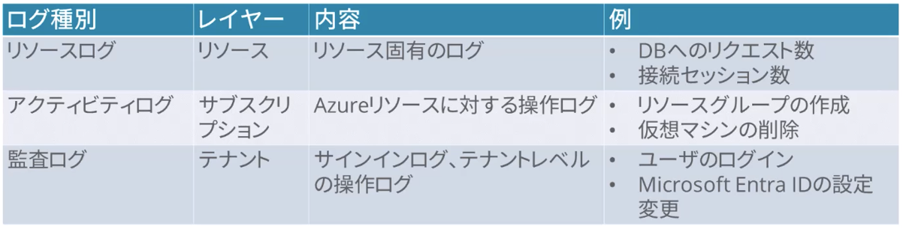
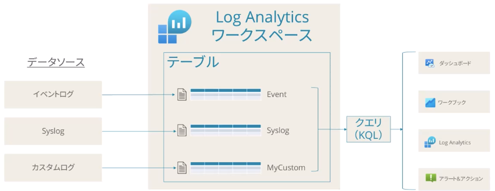
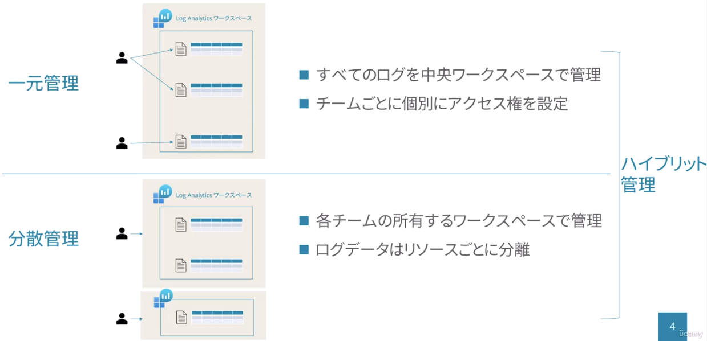
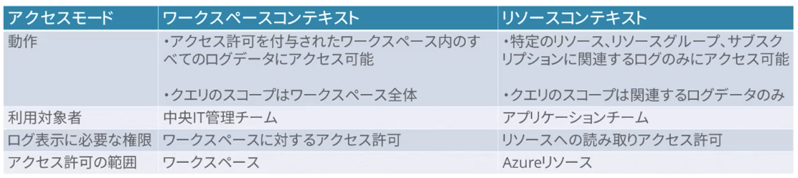
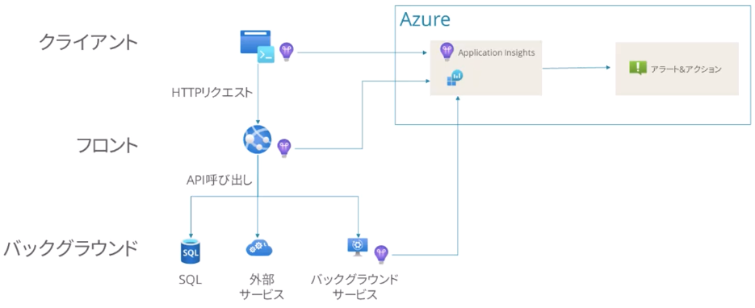

# 監視

## 監視の概要

### データソース（監視対象）

| データソース（監視対象） | データ                                                |
| ------------------------ | ----------------------------------------------------- |
| アプリケーション         | アプリケーションデータ                                |
| インフラ                 | オペレーティングシステムデータ、コンテナデータ        |
| Azureプラットフォーム    | Azureリソース、Azureサブスクリプション、Azureテナント |
| カスタムリソース         | カスタムログ、オンプレミス、他のパブリッククラウド    |

### データストア（データ種別）

| 種別       | 特徴                                                                     |
| ---------- | ------------------------------------------------------------------------ |
| メトリック | 数値データ 軽量、リアルタイムに近い収集頻度 アラート               |
| ログ       | テキストまたは数値データ イベント発生時などの散発的に収集 原因分析 |

### データ利用

| 利用                | サービス・ツール                                                          |
| ------------------- | ------------------------------------------------------------------------- |
| 洞察（Insights）    | Application Insights、Container Insights、VM Insights、Network Watcher... |
| 視覚化（Visualize） | ダッシュボード、ワークブック、Power BI...                                 |
| 分析（Analyze）     | メトリックスエクスプローラー、Log Analytics                               |
| 対応（Respond）     | アラート・アクション、オートスケール、Logic Apps                          |
| 統合（Integrate）   | Event Hubs、Azure Storage、Export API...                                  |

### Azure Monitor

データソース、データストア、データ利用を統合的に管理するプラットフォーム

## 監視データの取得

### データソース別の収集方法

### Azureプラットフォームログ

## Log Analyticsの設計

- Azure Monitorの基盤となるサービス。監視の殆どのケースで登場する
- ログの保存場所（ワークスペース）とログの分析機能を提供する

### Log Analyticsのデータ構造

- Log Analyticsのワークスペース：ログの保存場所
- ワークスペースのテーブル：ログデータの保存場所、各データソースに対して定義する
- テーブルに対してKQLというクエリ言語を発行する

### ワークスペースの設計

一元管理、分散管理、ハイブリッド管理

### ワークスペースのアクセス制御

アクセスモードを設定することで、データへの適切なアクセス制御を設定可能

- ワークスペースコンテキスト：ワークスペース単位のアクセス許可
- リソースコンテキスト：特定のリソース、リソースグループ、サブスクリプションに対するアクセス許可

## 分析情報の設計

Insightsサービスをアーキテクチャに組み込むことで、システムのパフォーマンス問題の原因特定が可能

- Application Insights
  - アプリケーション正常性とパフォーマンス問題の特定と対処
  - アプリケーションの開発ライフサイクルの改善
  - ユーザーエクスペリエンスの測定と分析
- VM Insights
  - VM正常性とパフォーマンスの特定と対処
  - 複数のサブスクリプションとリソースグループにまたがったVM監視
  - VMとスケールセットのプロセスとネットワーク接続表示

### Application Inshgts

アプリケーション全体のコンポーネントにまたがったパフォーマンスの監視を実行

