# インフラストラクチャ

## インフラストラクチャソリューション

1. コンピューティングソリューションを設計する
2. アプリケーションアーキテクチャを設計する
3. ネットワークソリューションを設計する
4. 移行を設計する（別セクション）

### 1. コンピューティングソリューションを設計する

1. ワークロード要件に基づいてコンピューティングソリューションのコンポーネントを指定する
2. 仮想マシンベースのソリューションを推奨する
3. コンテナベースのソリューションを推奨する
4. サーバレスベースのソリューションを推奨する
5. バッチ処理向けのコンピューティングソリューションを推奨する

※高可用性向けの設計の以下の内容も扱う
コンピューティング向けの高可用性ソリューションを推奨する

### 2. アプリケーションアーキテクチャを設計する

1. メッセージングアーキテクチャを推奨する
2. イベントドリブンアーキテクチャを推奨する
3. API統合のソリューションを推奨する
4. アプリケーションのキャッシュソリューションを推奨する

### 3. ネットワークソリューションを設計する

1. Azureリソースをインターネットに接続する接続ソリューションを推奨する
2. Azureリソースをオンプレミスネットワークに接続する接続ソリューションを推奨する
3. ネットワークパフォーマンスを最適化するソリューションを推奨する
4. ネットワークセキュリティを最適化するためのソリューションを推奨する
5. 負荷分散とルーティングソリューションを推奨する

### 4. 移行を設計する（別セクション）

1. Azuer向けのMicrosoftクラウド導入フレームワークを利用した以降ソリューションを評価する
2. オンプレミスのサーバー、データ、アプリケーションの移行を評価する
3. サービスとしてのインフラストラクチャ（IaaS）とサービスとしてのプラットフォーム（PaaS）にワークロードを移行するためのソリューションを推奨する
4. データベースを移行するソリューションを推奨する
5. 非構造化データを移行するソリューションを推奨する

## コンピューティングソリューションの設計

1. コンピューティングソリューションの選択
2. 仮想マシン
3. Azure Batch
4. Azure App Service
5. コンテナサービス
6. サーバレスコンピューティング

## 1. コンピューティングソリューションの選択

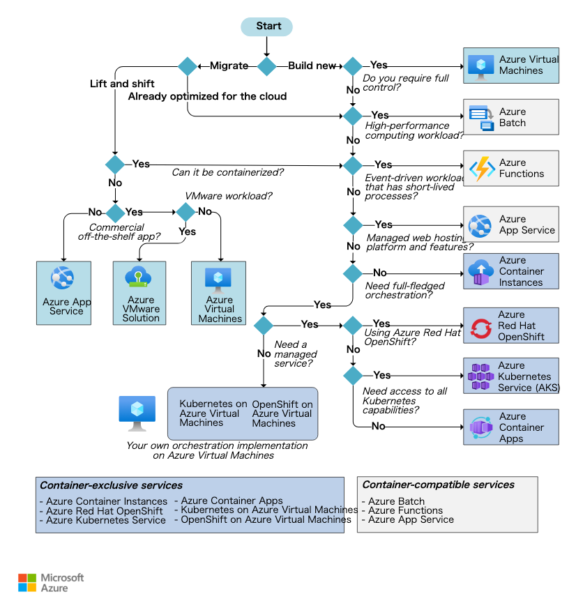

## 2. 仮想マシン

- 簡易な開発・テスト環境
- 他のサービスでは難しい大規模な処理能力(GPU、メモリ)
- オンプレミス環境の拡張・移行
- サードパーティ製品・レガシーアプリの稼働
- OSレベルでの制御が必要

※仮想マシン特有のライセンスや、ハードウェアの制約には注意が必要

### 仮想マシンを選択するべき時

他に選択肢がない時

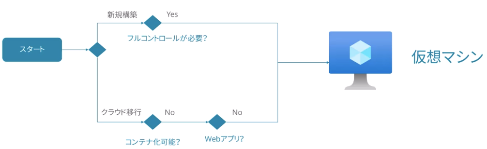

### 仮想マシンのサイズ選択

| 種別                     | シリーズ  | 用途                                                                         |
| ------------------------ | --------- | ---------------------------------------------------------------------------- |
| 汎用コンピューティング   | Dシリーズ | ほとんどの運用ワークロード                                                   |
| メモリ最適化             | Eシリーズ | メモリ負荷の高いアプリケーション（例：SAP HANA）                             |
| コンピューティング最適化 | Fシリーズ | コンピューティング集中型ワークロード（例：バッチ処理、分析）                 |
| バースト対応仮想マシン   | Bシリーズ | 通常利用時のコストを最適化したいワークロード（例：開発サーバ、ビルドサーバ） |
| GPUが有効な仮想マシン    | Nシリーズ | NVIDIA GPUが必要なワークロード（例：ディープラーニング、グラフィック）       |

#### 可用性セットと可用性ゾーン

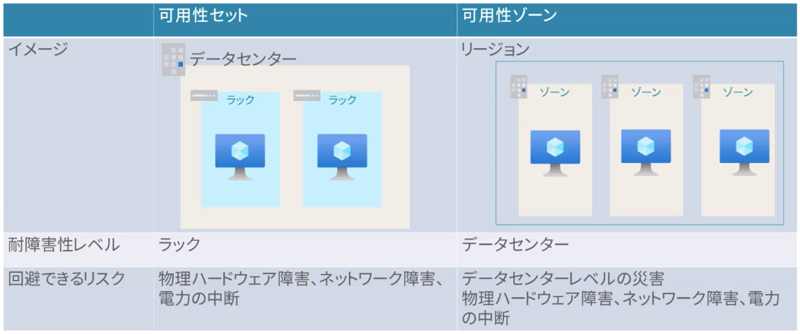

#### 複数の仮想マシンと仮想マシンスケールセット

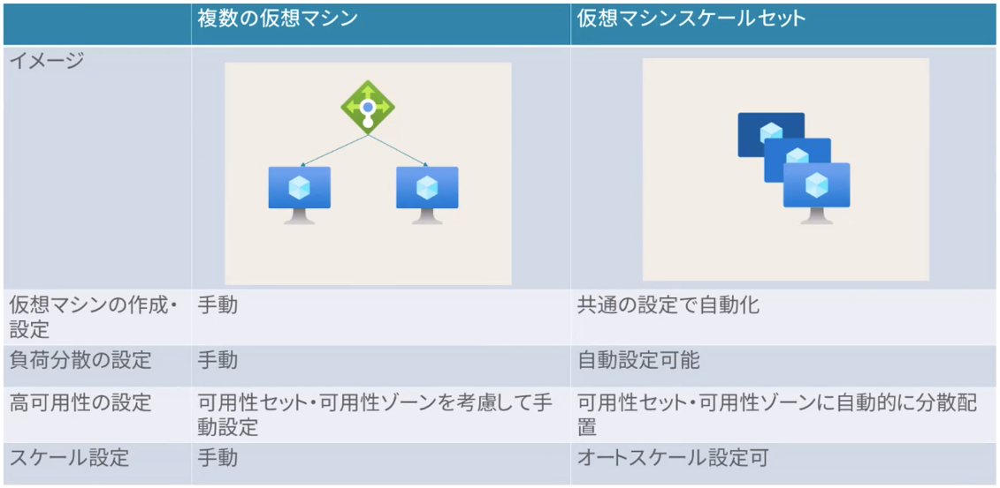

## 3. Azure Batch

大規模並列計算、HPCジョブのためのサービス

- Azure Bacthアカウント | 使用するリソースやジョブなどを管理する
- ジョブ | 処理内容を定義したタスクのコレクション
- プール | コンピューティングリソースをまとめる
- ノード | 計算をする実体となる仮想マシン

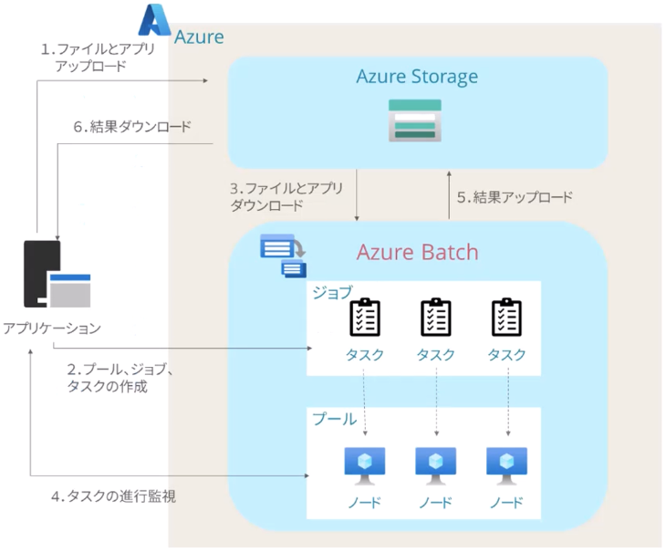

- 大規模な並列コンピューティング
- ハイパフォーマンスコンピューティング（HPC）ジョブ
- 3Dレンダリング
- モンテカルロシミュレーション（財務シミュレーション）

※いわゆる”バッチ処理”用途ではないことに注意

## 4. Azure App Service

HTTPベースのアプリケーションを構築・ホストする

### App Serviceを選択するべき時

PaaSとｓｈちえ便利な機能を利用し、運用工数を削減、アプリ開発二集中できる

- Web、バックエンドジョブ、モバイルバックエンド、RESTful API
- 自動スケーリングと高可用性
- デプロイメントスロット
- 統合されたCI/CD（GitHub、Azure DevOps）
- 統合された認証機能（Easy Auth）

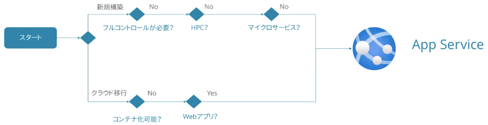

## 5. コンテナサービス

### コンテナサービスの選択肢

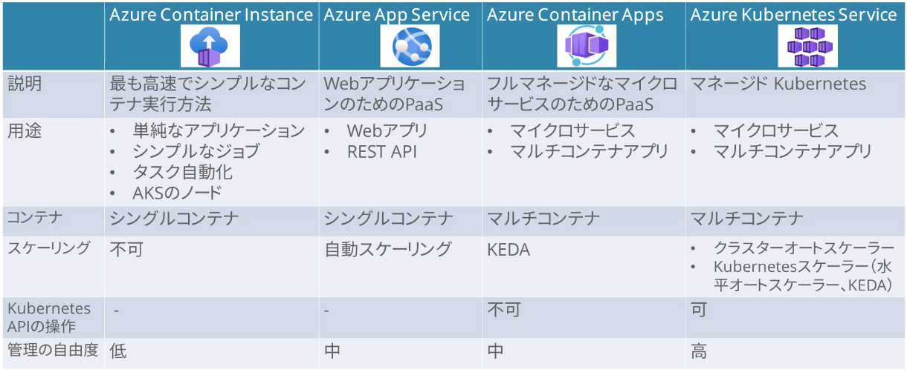

### AKSのスケーリング

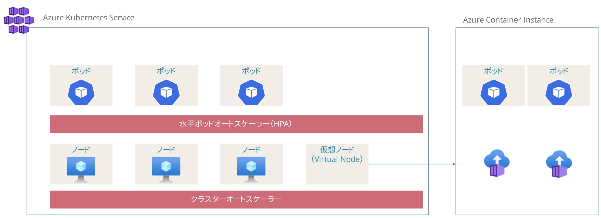

- クラスターオーケストレーター | リソースの利用率に合わせてノードをスケーリングする
- 水平ポッドオートスケーラー（HPA） | Kubernetesの機能でポッドを自動的にスケーリングする
- 仮想ノード | ACIを使って数秒でポッドを起動・実行する機能（仮想マシンの起動には時間がかかる）

## 6. サーバレスコンピューティング

### Azure Functionsを選択するべき時

イベントドリブンのアプリケーションを構築する場合

1. ホスティングプラン（従量課金、Premium、専用プラン）
2. ストレージ構成
3. 堅牢なコード（実行時間、ステートレス、再試行など）
4. セキュリティ（HTTPS、承認スコープなど）

[ベストプラクティス](https://learn.microsoft.com/ja-jp/azure/well-architected/service-guides/azure-functions)

#### ホスティングプラン

|                      | 従量課金<br>(Consumption) | Premium                                                 | 専用(AppService)                |
| -------------------- | ------------------------- | ------------------------------------------------------- | ------------------------------- |
| 用途                 | イベントドリブンアプリ    | CPU、メモリが必要なアプリ<br>仮想ネットワーク接続が必要 | 実行時間が長いアプリ            |
| スケール             | 自動(イベントドリブン)    | 自動(イベントドリブン)                                  | 手動/自動<br>(App Service Plan) |
| コールドスタート     | あり                      | なし                                                    | なし                            |
| 仮想ネットワーク接続 | 不可                      | 可                                                      | 可                              |
| 最大実行時間         | 10分                      | 無制限                                                  | 無制限                          |
| 課金                 | 実行分のみ                | ウォームアップ分+実行分                                 | App Service Plan                |

### 参考：Flex従量課金プラン

[Flex従量課金プラン](https://learn.microsoft.com/ja-jp/azure/azure-functions/flex-consumption-plan)

|                      | 従量課金<br>(Consumption) | Flex従量課金<br>(2024年11月GA) |
| -------------------- | ------------------------- | ------------------------------ |
| 用途                 | イベントドリブンアプリ    | イベントドリブンアプリ         |
| スケール             | 自動(イベントドリブン)    | 自動(イベントドリブン)         |
| コールドスタート     | あり                      | あり<br>Always-Ready設定可     |
| 仮想ネットワーク接続 | 不可                      | 可                             |
| 最大実行時間         | 10分                      | 無制限                         |
| 課金                 | 実行分のみ                | ウォームアップ分+実行分        |

### Logic Appsを選択するべき時

クラウドベースのワークフローを構築する時

```text
## オンプレミスや書くSaaSとの連携のための標準コネクターが用意されている
ストレージアカウント  ┐　　　　　　　　　　　　　　　　　　　┌ メール送信（Outlook）
Azure Functions　　　 │ーー Logic Apps　ーー│　ファイル共有（SharePoint）
Cognitive Service 　┘         │　　　　　　　　 └ チャット通知（Teams）
　　　　　　　　　　　　　　　　　　　　　　　　　　　　　│
　　　　　　　　　　　　　　　　　　オンプレミスデータゲートウェイ
　　　　　　　　　　　　　　　　　　　　　　　　　　　　　│
　　　　　　　　　　　　　　　　　　DBサーバ/ファイルサーバ/SAP
```

### Azure FunctionsとLogic Appsの比較

|      | Azure Functions                                          | Logic Apps                                                          |
| ---- | -------------------------------------------------------- | ------------------------------------------------------------------- |
| 開発 | コードファースト                                         | デザイナーファースト（GUI）                                         |
| 接続 | ・ビルトインのバインド（約10種類）<br>・カスタムバインド | ・豊富な標準コネクタ<br>・B2B統合ワークフロー<br>・カスタムコネクタ |
| 監視 | Application Insights                                     | Azure Portal<br>Azure Monitor Log                                   |

## アプリケーションアーキテクチャの設計

1. メッセージングとイベントの概要
2. メッセージングソリューション
3. イベントソリューション
4. Azure API Management
5. Azure Cache for Redis

### イベントとメッセージ

情報の発信者（パブリッシャー）が発信した情報を、情報の受け手（コンシューマー）が受け取るための仕組み

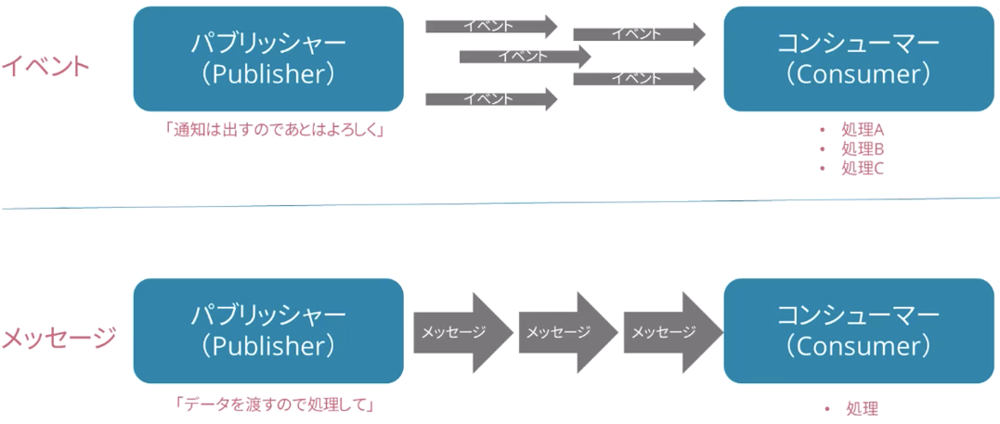

#### イベントとメッセージの比較

| 項目     | イベント                                     | メッセージ                                                   |
| -------- | -------------------------------------------- | ------------------------------------------------------------ |
| データ   | 状態または状態変更の軽量な通知データ         | サービスによって生成される生データ                           |
| 処理方法 | 受信者が決める（処理されないこともある）     | 発行元が決める                                               |
| 用途     | スケーリングが必要なサーバレスソリューション | 後続のコンポーネントによる確実な処理が必要なアプリケーション |

#### イベントの例

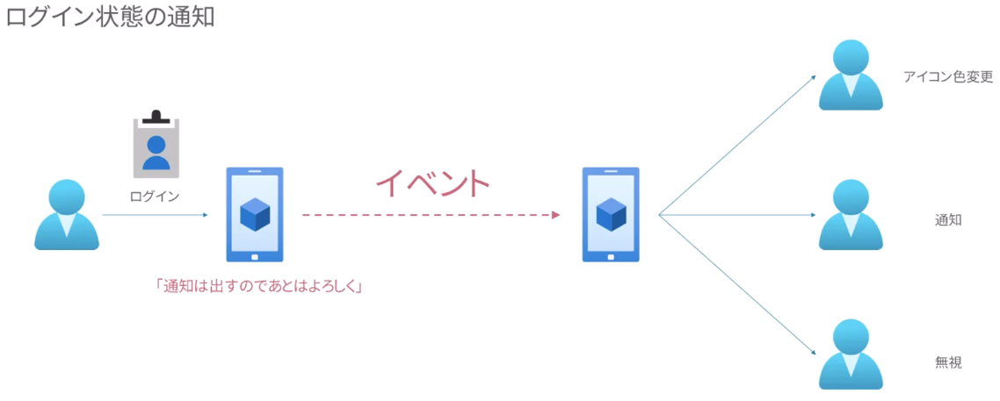

#### メッセージの例

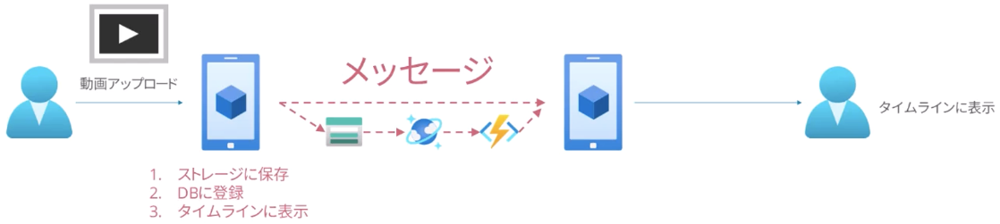

## メッセージングソリューションの設計

- Azure Queue Storage
- Azure Service Bus

### キューの検討ポイント

- メッセージの順序 | 先入れ先出し（FIFO）を厳密に守るか、多少の前後を許容するか
- 配信の仕方
  - 最低1回（At-Least-Once）
  - 最大1回（At-Most-Once）

### Azure Queue storage

ストレージアカウントベースのシンプルなキューサービス

- 順序保証無し
- 配信は最低1回（At-Most-Once）のみ
- 大量のメッセージを扱える（80GB）

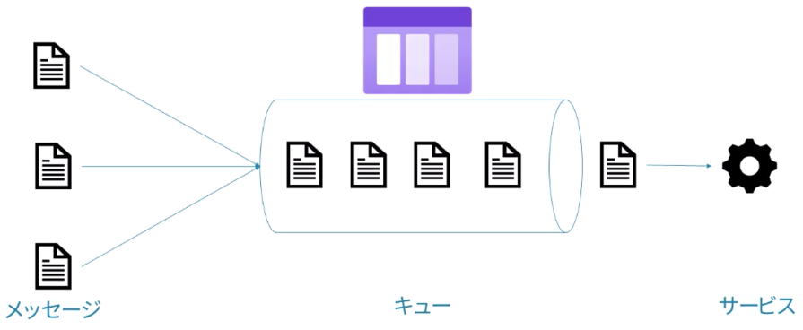

### Azure Service Bus

フルマネージドエンタープライズ統合メッセージブローカー

- 先入れ先出し（FIFO）
- 配信は、最低1回（At-Least-Once）／最大1回（At-Most-Once）を選択可

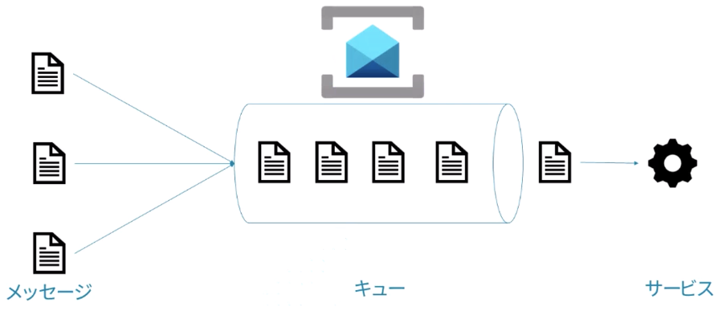

キューとトピック

- キュー：1つのメッセージで1つの受信者に配信
- トピック：1つのメッセージを複数のキューにコピーして複数の受信者に配信

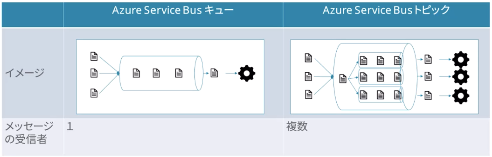

## イベントソリューションの設計

- Azure Event Hub
- Azure Event Grid

### Azure Event Hub

フルマネージドリアルタイムデータインジェストサービス

- 秒間で数万単位のイベントを処理できる
- 取り込んだイベントデータはイベントハブ内のパーティション領域に追加される
- 各イベントをストレージアカウントに保存することもできる
  - BLOBストレージ or データレイクストレージ
  - データはAVRO形式
- 後続サービスが取り込んだイベントをPull方で処理する

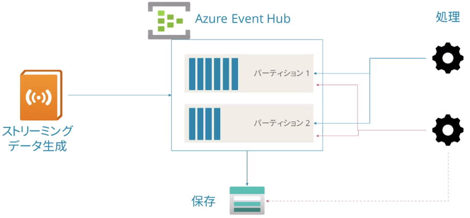

### Azure Event Grid

フルマネージドイベントルーティングサービス

イベントの宛先を細かく設定する

- 例）ストレージアカウントにデータが保存されたというイベントを、Azure Functionsに連携する

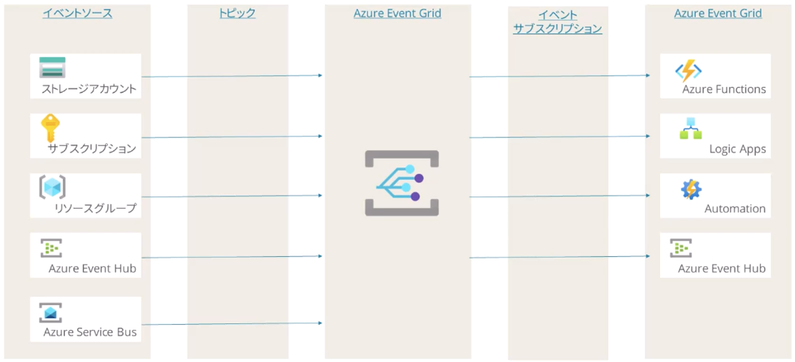

### イベントとメッセージソリューションの比較

適材適所で組み合わせながらソリューションに組み込む

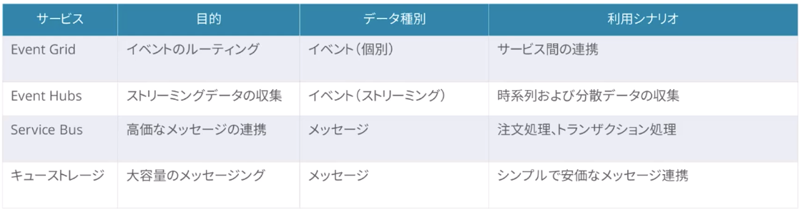

## Azue API Management

APIを公開、セキュリティ保護、保守、分析するためのプラットフォーム

- AKS、Functions、AppServiceのAPIレイヤーを外出しできる
- 標準で管理者ポータルも自動的に生成される
- APIリスクエストはゲートウェイを経由し、監視やコール数を制限できる

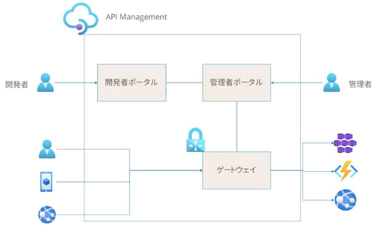

### Azure API Management レベル別機能

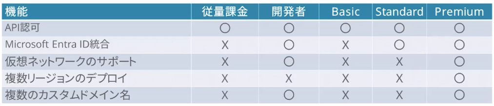

## Azure Cache for Redis (廃止予定)

※ 現在はAzure Managed Redis

アクセス頻度の高いデータを保持して、アプリケーションのレスポンス速度を改善する

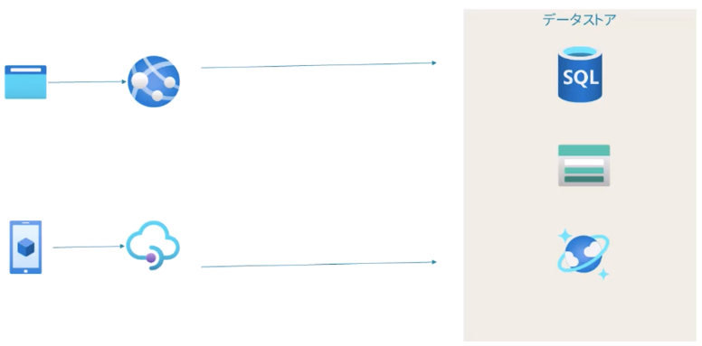
