# データストレージ

## データ構造の種別

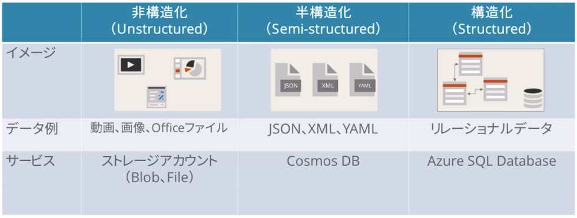

## 試験概要：データストレージソリューション

1. 非構造化データのデータストレージソリューションを設計する
2. 半構造化データのデータストレージソリューションを設計する
3. リレーショナルデータのデータストレージソリューションを設計する
4. データ統合を設計する

### 1/2. 非構造化および半構造化データのデータストレージソリューションを設計する

1. 非構造化データを格納するためのソリューションを推奨する
2. 半構造化データを格納するためのソリューションを推奨する
3. 機能、パフォーマンス、コストのバランスを考慮したデータ・ストレージソリューションを推奨する
4. 保護と持続性に対応するデータソリューションを推奨する

※ コストやパフォーマンス、データの冗長性を含む

### 3. リレーショナルデータのデータストレージソリューションを設計する

1. リレーショナルデータを格納するためのソリューションを推奨する
2. データベースサービスレベルとコンピューティングレベルを推奨する
3. データベースのスケーラビリティのためのソリューションを推奨する
4. データ保護のソリューションを推奨する

### 4. データ統合を設計する

1. データ統合用のソリューションを推奨する
2. データ分析用のソリューションを推奨する

---

## 非構造化データのデータストレージソリューションの設計

1. ストレージアカウントの概要
2. データの冗長性
3. Blobストレージ
4. ファイルストレージ
5. ディスクストレージ
6. ストレージのセキュリティ

## ストレージアカウントの概要

### ストレージアカウントの設計ポイント

非構造化データの保存場所はストレージアカウント

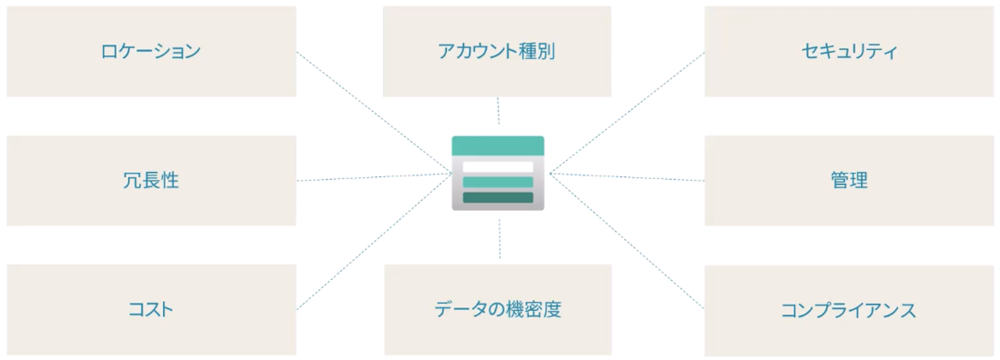

### ストレージアカウント種別の選択

サポートされているサービスと、利用目的によりアカウント種別を選択する

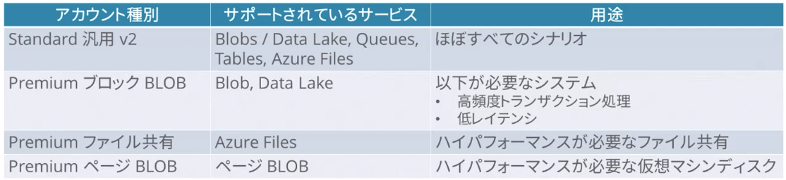

## データの冗長性

障害発生に備え、必要な可用性と耐久性の要件に合わせて冗長性を選択する

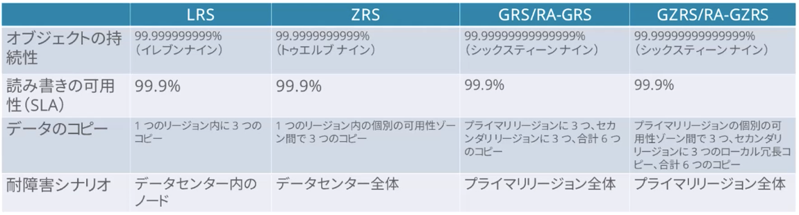

### ローカル冗長ストレージ（Local Redudant Storage, LRS）

- プライマリリージョンのデータセンター内でデータが3重にコピーされる
- データセンター内のノード（ラック）単位での耐障害性

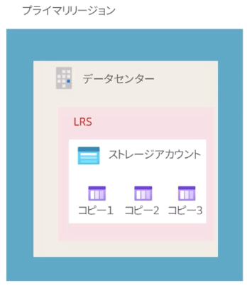

### ゾーン冗長ストレージ（Zone Redundant Storage, ZRS）

- プライマリリージョン内の3つ可用性ゾーンにまたがってコピーされる
- データセンターレベルでの耐障害性

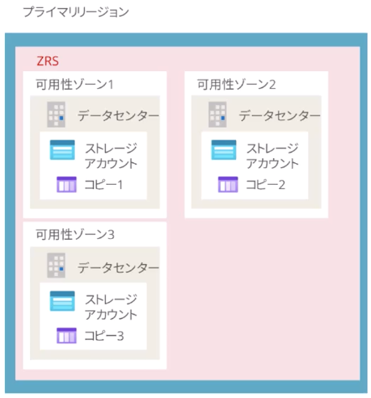

### ジオ冗長ストレージ（Geo Redundant Storage, GRS）

バックアップをペアリージョン（セカンダリリージョン）に保存する

- セカンダリリージョンにデータを3重にコピー
  - リージョン間コピーは非同期となる
- プライマリリージョンレベルでの耐障害性

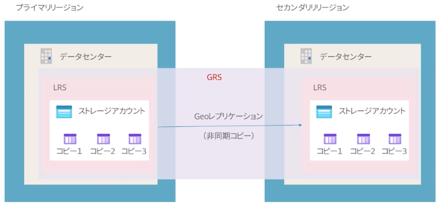

### ジオゾーン冗長ストレージ（Geo Zone Redundant Storage, GZRS）

- セカンダリリージョンの"LRS"に3重コピー
- プライマリリージョンレベルでの耐障害性

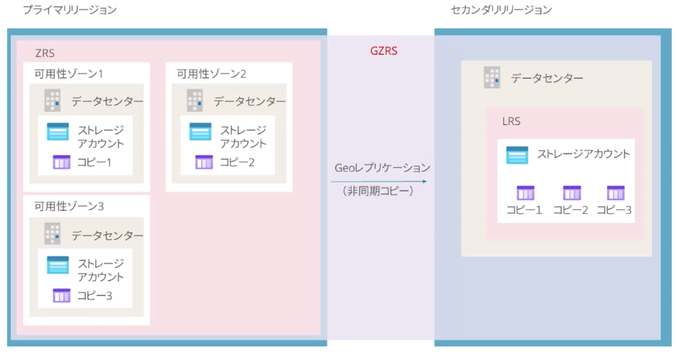

## Blobストレージ

### アクセス層の選択

データの保存／アクセス要件とコストのトレードオフに基づいて選択する

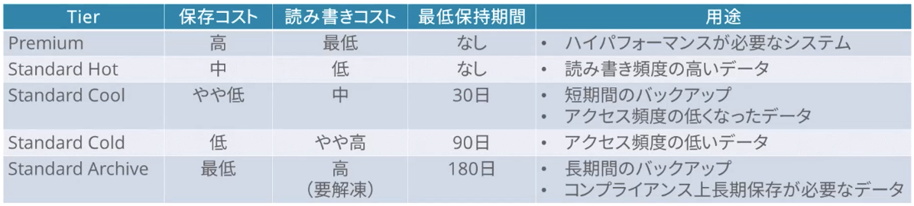

### ライフサイクル管理

データのアクセス頻度に応じて自動的にアクセス層を変更・削除する

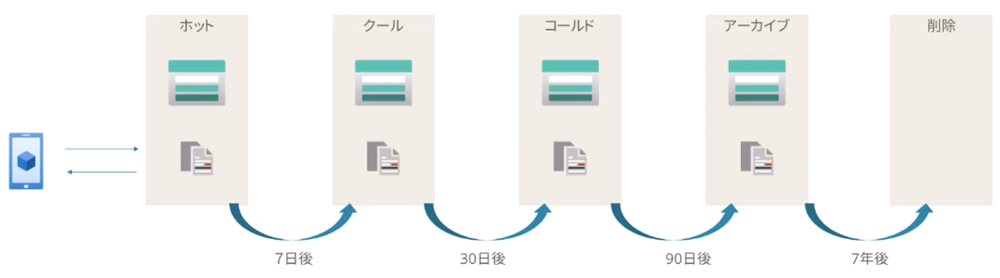

## ファイルストレージ

### アクセス層の選択

データの保存・アクセス要件とコストのトレードオフに基づいて選択する

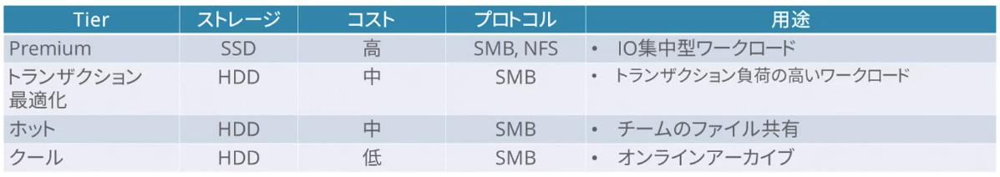

### Blobストレージとファイルストレージの比較

ユースケースやプロトコル・パフォーマンス要件により選択する

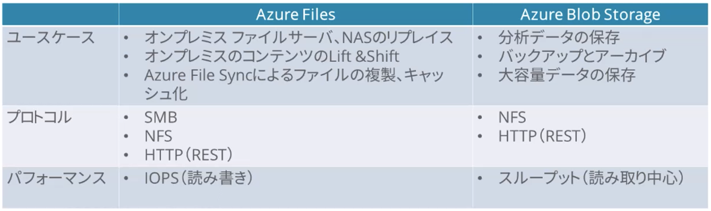

### 参考：Azure NetApp　Files

エンタープライズワークロード向けのハイパフォーマンスファイルストレージ

- AzureネイティブでMicrosoftファーストパーティのサービス
- オンプレミスのNetApp（NAS）の移行
- 特定のワークロードで必須級のサービス
  - SAP on Azure
  - Azure Virtual Desktop（VDI）
  - HPC
  - AVS

## ディスクストレージ

Azure VM（仮想マシン）に接続して利用する仮想ディスク（AWSでいうEBS）

### ディスクの検討ポイント

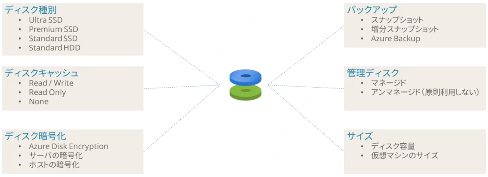

### ディスク種別の選択

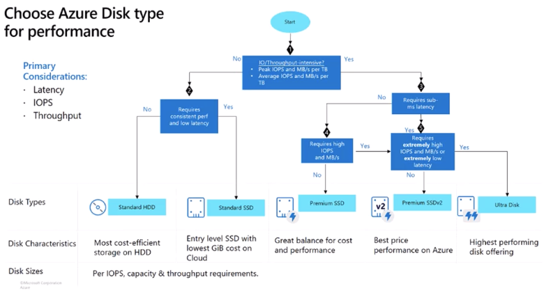

必要なパフォーマンスに基づいて選択する

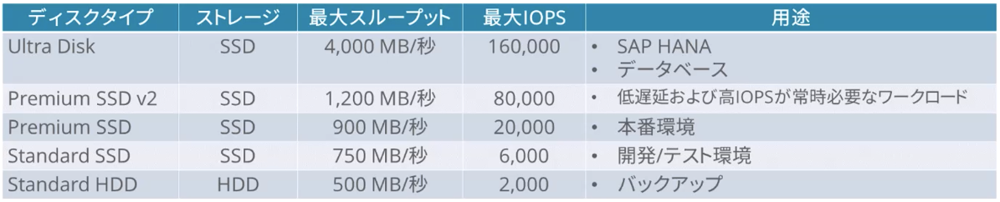

## ストレージのセキュリティ

### ストレージセキュリティの検討ポイント

データに対して複数レイヤーでのデータ保護を実施する

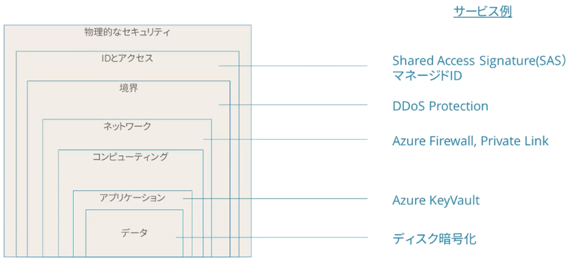

---

## 半構造化データのデータストレージソリューションの設計

1. Azure Cosmos DBの概要
2. Cosmos DB APIの選択

## Azure Cosmos DBの概要

フルマネージドNoSQLデータベース

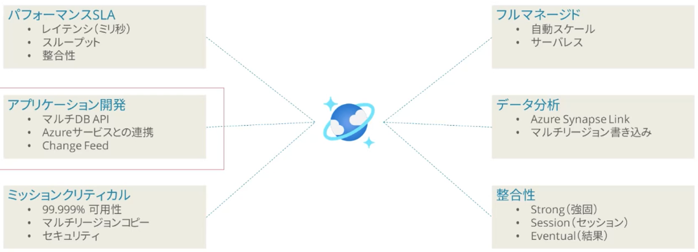

### Azure Cosmos DBの階層構造

Azure Cosmos DBの利用には、最初にアカウントを作成し、データベースとコンテナを作成する

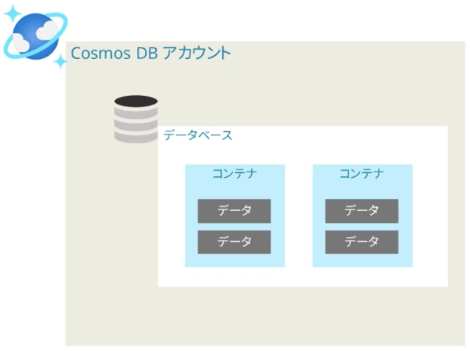

### Azure Synapse Link for Azure Cosmos DB

Azure Cosmos DBとAzure Synapse Linkの間に緊密でシームレスな統合

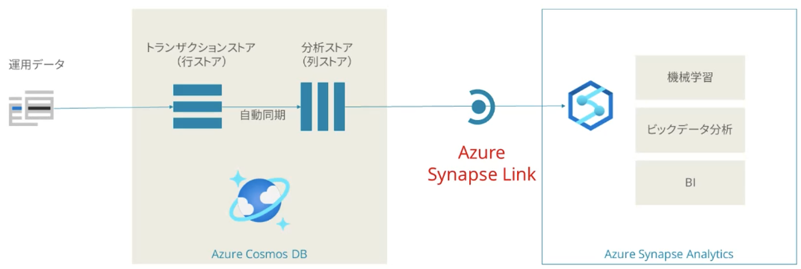

## Cosmos DB APIの選択

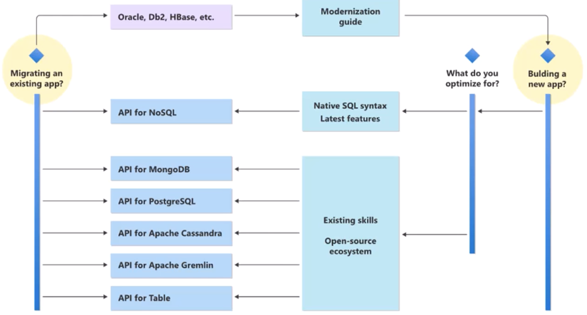

### APIの比較

互換性が必要な場合は各API、最新機能を使いたい場合はNoSQLを採用する

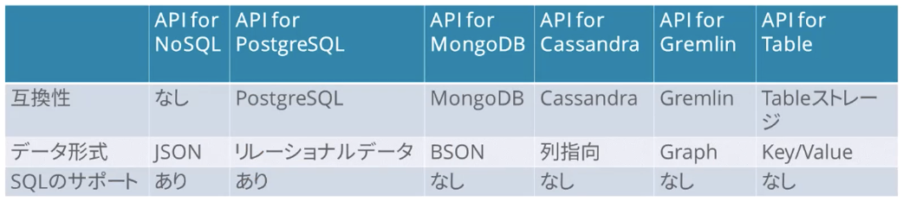

---

## リレーショナルデータのデータストレージソリューションの設計

- Azure SQLの概要
- データベースの可用性
- データベースのセキュリティ

## Azure SQLの概要

### SQLサービスの比較

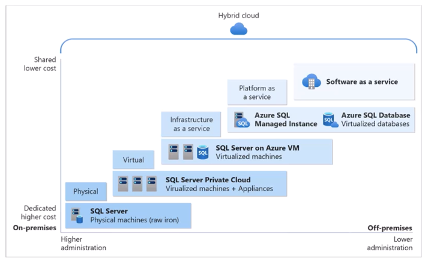

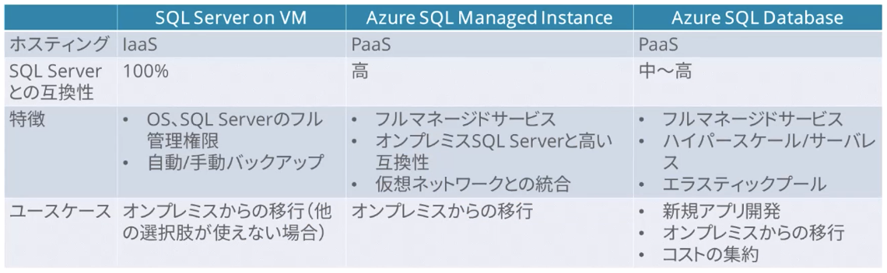

### Azure SQL Databaseの価格モデル

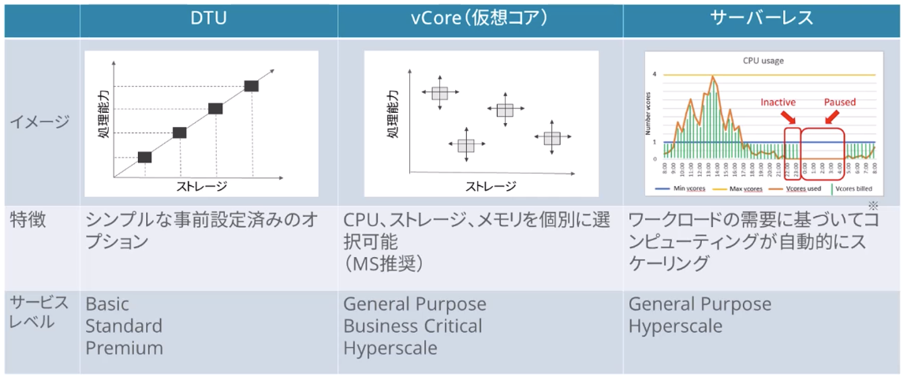

### エラスティックプール

利用パターンの異なるDBを集約することでコストの大幅な削減を実現

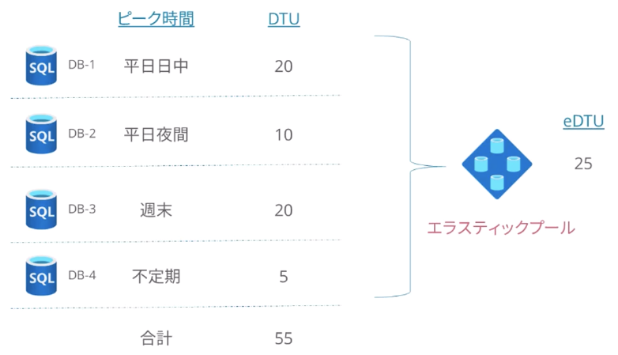

## データベースの可用性

アプリケーションの要件に合わせて適切なサービス層を選択する

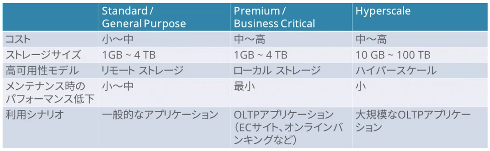

### Standard/General Purpose

コンピューティングレイヤーとステートフルデータレイヤーが分離されている（リモートストレージ）

- フェイルオーバー時にスペアノードが完全に立ち上がるまでに時間にパフォーマンスが低下する可能性がある

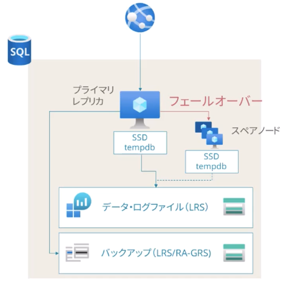

### Premium/Business Critical

ローカルストレージと計算リソースが統合されており、可用性グループを構成している

- プライマリと複数のセカンダリで、AlwaysOn可用性グループを構成する
- プライマリとセカンダリは常にデータが最新となるように保たれている
- ダウンタイムが最小となる構成

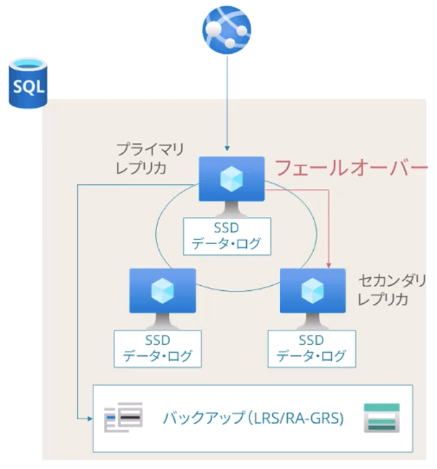

### Hyperscale

各コンポーネントが分離されており、独立した可用性・スケーリングが可能

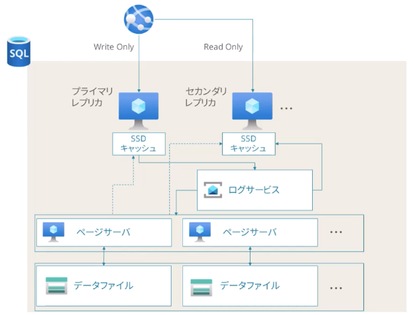

## データベースのセキュリティ

### ストレージセキュリティの検討ポイント

データに対して複数レイヤーでのデータ保護を実施する

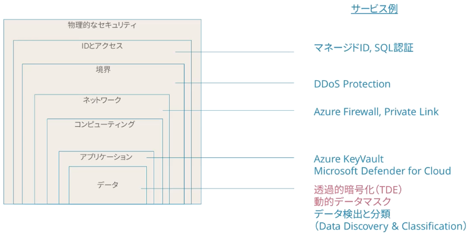

### 透過的なデータ暗号化（Transparent Data Encryption, TDE）

保存データを暗号化することによって、悪意のあるオフラインアクティビティの脅威から保護する

- Azure SQL Databaseではデフォルトで有効

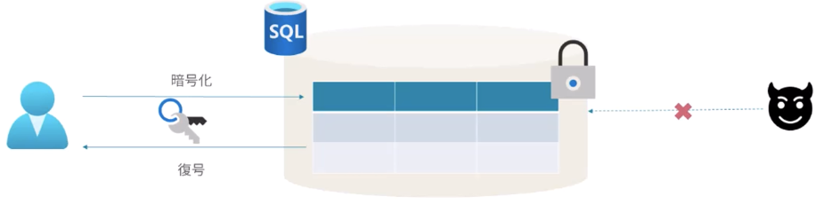

### 動的データマスク（Dynamic data masking）

特権のないでユーザに対して機密データをマスキングすることでデータの公開を制限する

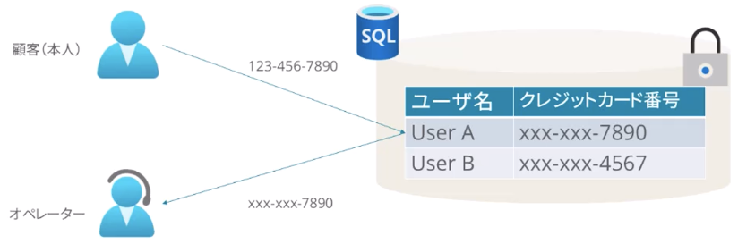

---

## データ統合の設計

1. データ統合・分析ソリューションの概要
2. Azure Data Factory
3. Azure Data Lake Storage
4. Azure Synapse Analysis
5. Azure Databricks

## データ統合・分析ソリューションの概要

### データ統合とは？

複数の異なるソースからデータを結合して、ユーザに単一の結合ビューを提供するプロセス

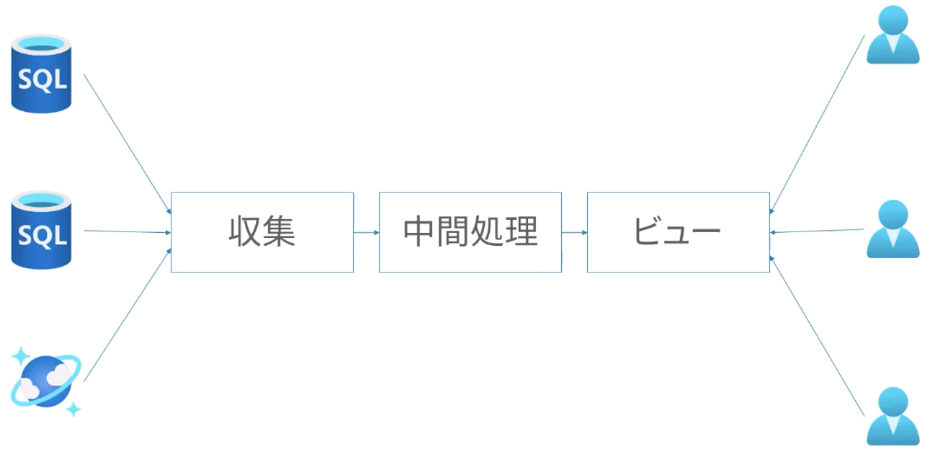

### データ統合ソリューション

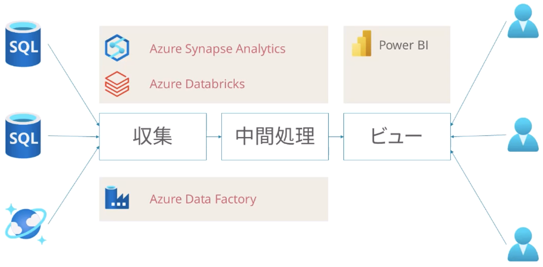

- Azure Synapse Analysis | データ統合・データ分析基盤
- Azure Databricks | データ統合・データ分析基盤
- Azure Data Factory | データ統合に特化

### 参考：Microsoft Fabric

データ分析基盤SaaS

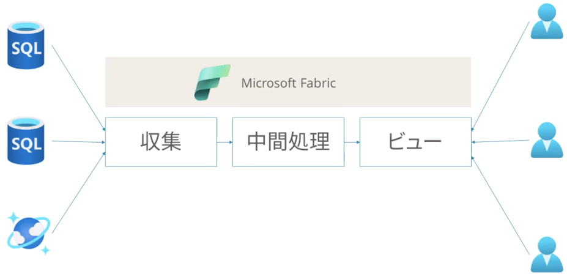

## Azure Data Factory

クラウドベースのフルマネージドETLおよびデータ統合サービス

- ETL(Extract,Transform,Load) | データを取り出し、整え、保存する仕組み
- データ収集、変換はサーバレスモデルを採用し、自動スケーリング、従量課金

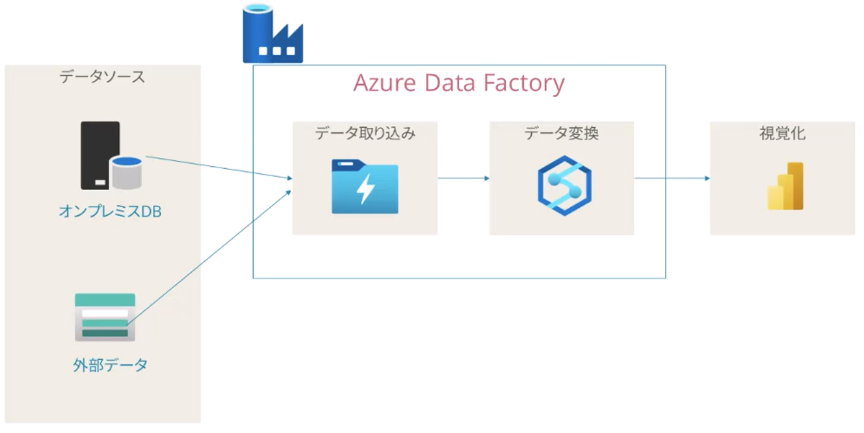

### Azure Data Factoryの用途

1. データの移動ジョブの管理
2. 大規模なデータ変換
3. SQL Server Integration Services(SSIS)のクラウド移行

### Azure Data Factoryの構成要素

データ統合プロセスをパイプラインとして定義して実行する

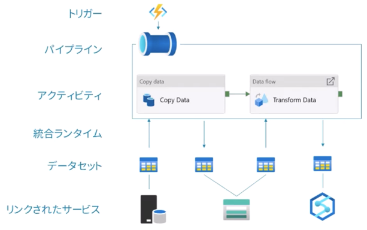

- リンクされたサービス | オンプレミスのDBやAzureの各種サービス
- データセット | リンクされたサービスのデータの実態（DBテーブル、ストレージファイル）
- 統合ランタイム（IR）| データセットとアクティビティを繋ぐ
  - Azure IR | Azure上にホストされたランタイム、Azureサービス間のデータのやりとり向け
  - Self Hosted IR | オンプレミスのリソースをデータファクトリーと連携させる時に使う
  - SSIS IR | Azure上のVMにホストされたSSIS専用のランタイム
- アクティビティ | 実際のデータに対する作業を定義する（データコピー、データ変換、条件分岐）
- パイプライン | アクティビティをグループ化したもの
  - パイプラインの作成≒データファクトリーの管理
- トリガー | パイプラインをいつ実行するかを定義する（スケジュール、手動、イベント）

## Azure Data Lake Storage

Azure Blob Storageをベースに構築された、ビッグデータ分析専用のストレージ

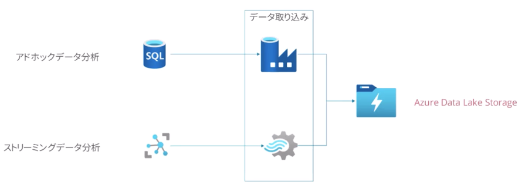

### Azure Data Lakeの特徴

| 特徴                 | 内容                                                             |
| -------------------- | ---------------------------------------------------------------- |
| 階層ディレクトリ構造 | データをディレクトリと入れ子になったサブディレクトリの階層に整理 |
| 大容量データの保存   | Apache Hadoop分散ファイルシステム（HDFS）との互換性              |
| セキュリティモデル   | アクセス制御リスト（ACL）をサポート                              |

### Azure Data LakeとAzure Blob Storageの比較

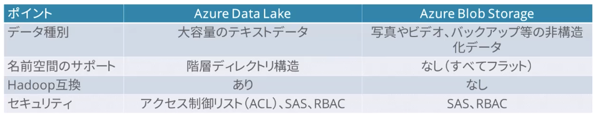

## Azure Synapse Analytics

データ統合、エンタープレライズ・データ・ウェアハウス、ビッグデータ分析、可視化を1つのサービスにまとめた統合分析プラットフォーム

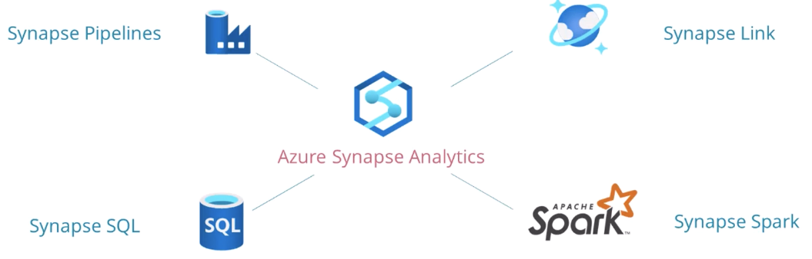

### Azure Synapse Analyticsの構成要素

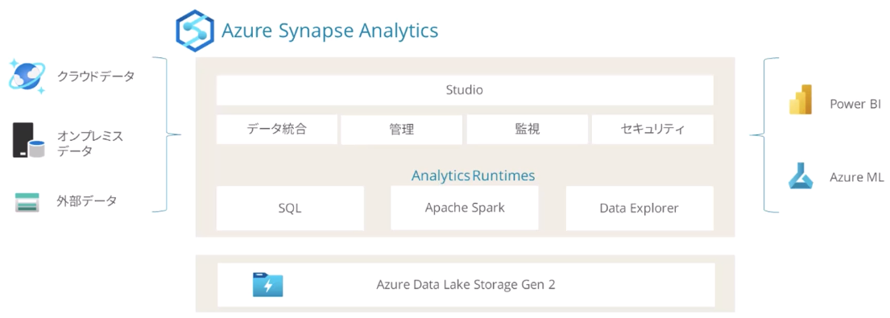

### Azure Data FactoryとAzure Synapse Analyticsの違い

統合ランタイムの共有、複数リージョンのサポートはAzure Data Factoryのみ

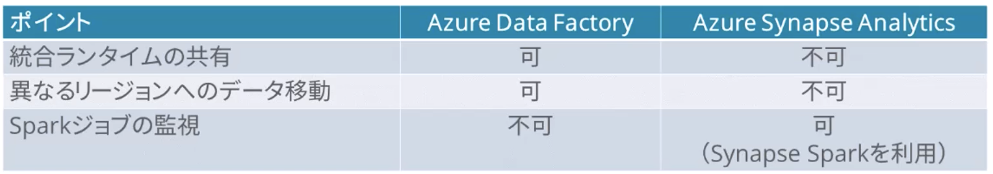

## Azure Databricks

フルマネージドのクラウドベースのビッグデータおよび機械学習プラットフォーム

- Apache Spark | Apache Sparkに最適化されたデータ分析基盤
- Databricksエコシステム | Delta Lake, MLFlow, Databricks I/O
- Azureエコシステム | Microsoftの1stパーティ製品、Azureのセキュリティ

### Azure Databricksのアーキテクチャ

- データ本体は利用者のAzureテナントで管理される
- 管理用のWebApp、APIははDatabricks側のアカウント管理
- SSOで同期させることができる

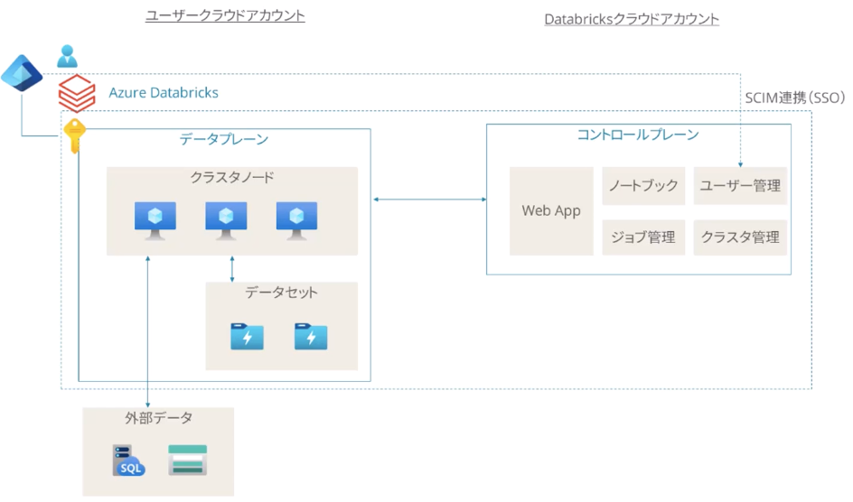

### Azure DatabricksとAzure Synapse Analyticsの違い

提供している機能が異なるので、場合によっては組み合わせて使う

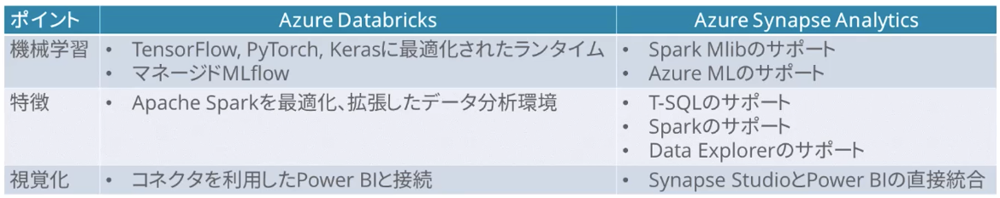
