# ビジネス継続性

## 試験概要：ビジネス継続性ソリューションを設計する

1. バックアップとディザスタリカバリソリューションを設計する
2. 高可用性を設計する

### 1. バックアップとディザスタリカバリソリューションを設計する

1. コンピューティングのためのバックアップソリューションを推奨する
2. データベースのためのバックアップソリューションを推奨する
3. 非構造化データのためのバックアップソリューションを推奨する
4. Azureとハイブリットワークロードのためのリカバリソリューションを推奨する

### 2. 高可用性を設計する

1. コンピューティングの高可用性ソリューションを推奨する
2. データベースの高可用性ソリューションを推奨する
3. 半構造化・非構造化データの高可用性ソリューションを推奨する

---

## バックアップとディザスタリカバリソリューションん

### バックアップとリカバリの設計ポイント

ビジネス要件に合わせて、適切なバックアップ・リカバリ方式を計画する

- ワークロード
  - 利用パターン
  - 利用価値
  - SLA
- メトリック
  - 平均復旧時間（MTTR・MTBF）
  - データの復元目標（RTO・RPO）

### 復旧のための目標値

バックアップの頻度やDR構成を決定する基準となる

- RPO(目標復旧時点)：障害時からどれぐらい直前のデータを復旧できるかの指標
- RTO(目標復旧時間)：障害時に復旧までにかかる目標時間

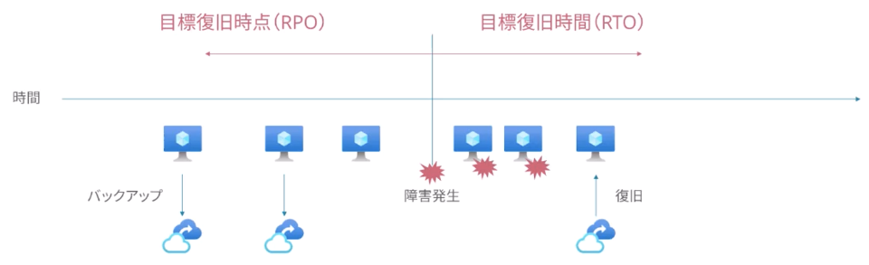

## Azure Backup

フルマネージドのバックアップ・リカバリソリューション

- 仮想マシン、Azure Files、オンプレミスサーバのバックアップ管理
- バックアップポリシー管理
  - バックアップ頻度、タイミング、保持世代、保持日数

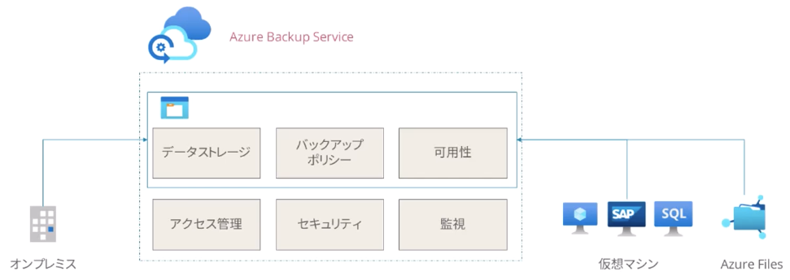

### 仮想マシンのバックアップ

仮想マシンの種別（SAP、SQLサーバなど）ごとにチューニングされた構成が可能

#### 仮想マシンの復元方式

障害の状況により最適な復旧方法が変わる

- 新規作成 | 別のリージョンやサブスクリプションも選択可
- ディスクの復元 | ディスク内のデータだけを取り出す
- 置き換え | IPやマシン名など、仮想マシンのスナップショットベースで丸ごと

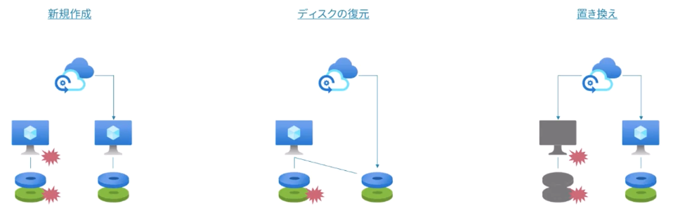

### Azure Filesのバックアップ

ストレージアカウントに保存するスナップショットを中央管理する

- スナップショットとして同じストレージアカウント保存される
- バックアップポリシー、スナップショットは別で管理

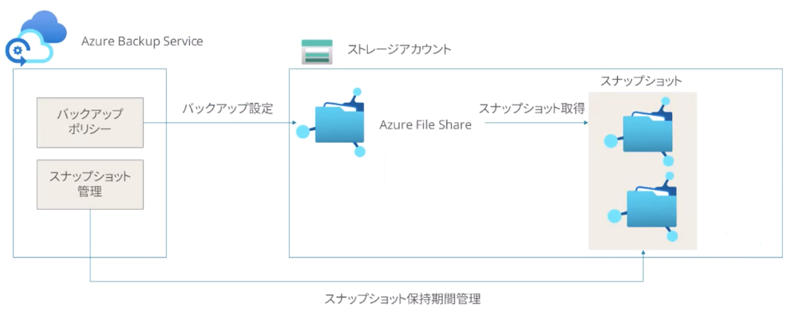

## Blobストレージのバックアップと復元

### Blobストレージのバックアップ機能

1. 論理的な削除（Soft Delete）
2. バージョン管理
3. ポイントタイムリストア

### 論理的な削除

誤って削除されないようにデータを保護する

- コンテナ、Blobレベルで設定可
- 指定したデータの保持期間であれば削除後も復元できる

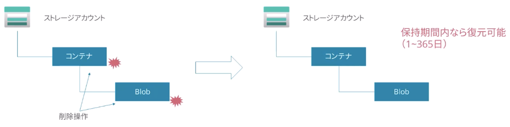

### バージョン管理

Blobの各ファイルのバージョンレベルで誤操作から保護する

- Blobレベルでの操作のたびにバージョン履歴が保存される
- 誤った操作をしても、バージョンを指定して復元できる

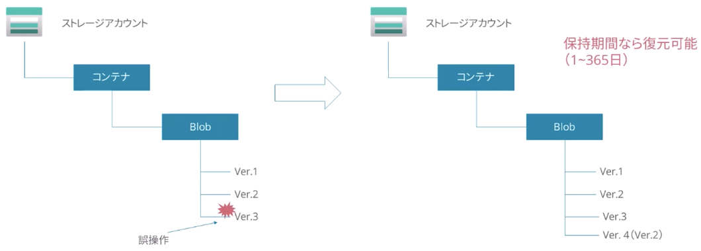

### ポイントタイムリストア

特定の状態にストレージアカウントの状態を丸ごと戻す

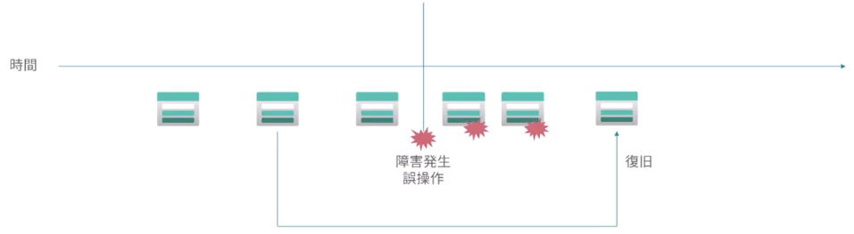

## Azure SQLのバックアップと復元

### Azure SQLのバックアップ

サービスの組み込みバックアップ機能がある

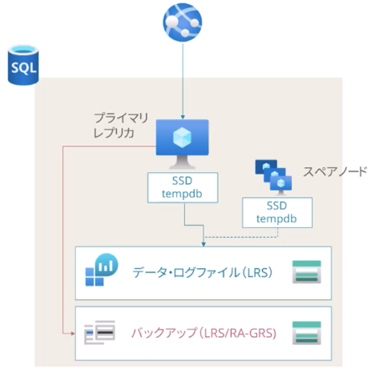

フルバックアップ・差分バックアップ・トランザクションログバックアップの組み合わせ

- 週次：フルバックアップ
- 日時：増分バックアップ（12時間〜24時間）
- 5分〜10分毎：トランザクションログのバックアップ
- バックアップの有効期間は35日
- 長期保存は最長10年間

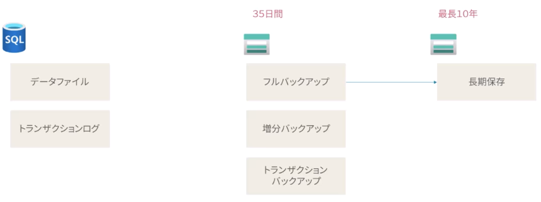

### ポイントタイムリストア

取得したバックアップから復元できる

### リージョン障害からの復元

RTO/RPOの観点で最適な方式を選択する

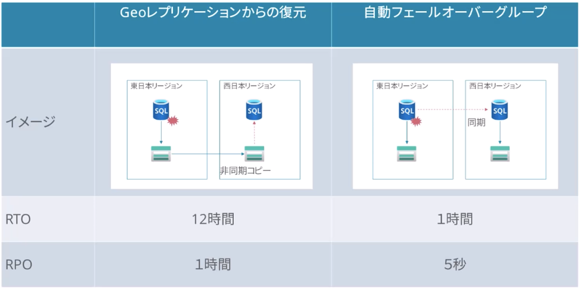

## Azure Site Recovery

Azureやオンプレミス上のシステム全体を別リージョンにフェールオーバー

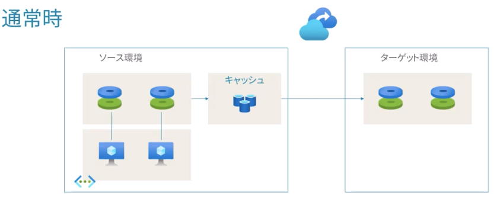

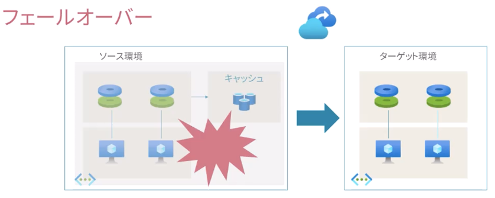
