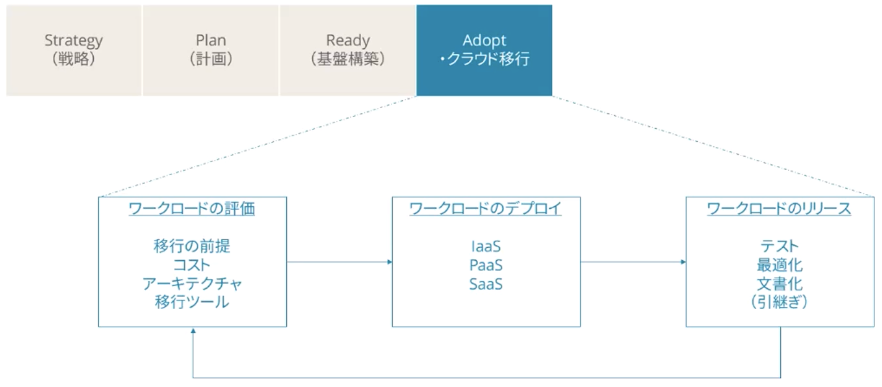
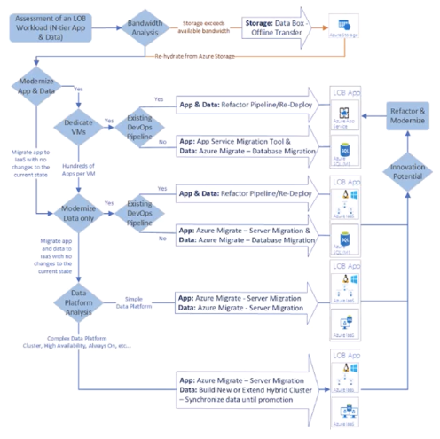
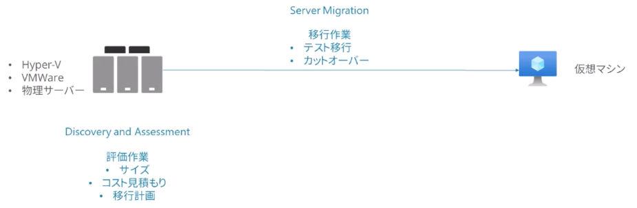
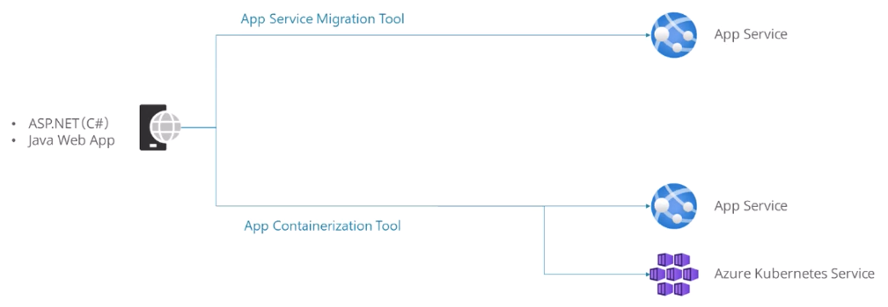
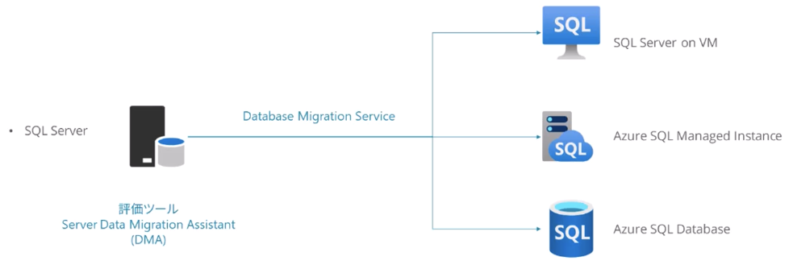
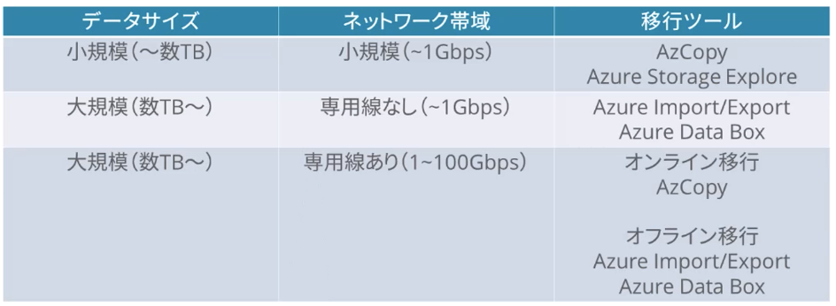

# 移行

## 試験概要：移行を設計する

1. Azure向けのMicrosoftクラウド導入フレームワークを利用した移行ソリューションを評価する
2. オンプレミスのサーバ、データ、アプリケーションの移行を評価する
3. サービスとしてのインフラストラクチャ(IaaS)とサービスとしてプラットフォーム(PaaS)にワークロードを移行するためのソリューションを推奨する
4. データベースを移行するソリューションを推奨する
5. 非構造化データを移行するソリューションを推奨する

---

## クラウド移行の概要

評価・構築・リリースの反復作業

## 移行ツール

### Azure Migrate

Azureへの移行を開始、実行、追跡するための統合プラットフォーム

- 評価ツール（アセスメント）
  - サーバーアセスメント
  - Web Appアセスメント
  - データベースアセスメント
- 移行ツール（マイグレーション）
  - サーバーマイグレーション
  - データベースマイグレーション
  - Data Box

### 移行ツール決定ガイド

### 仮想マシンの移行

- Discovery and Assesment
  - 移行先の仮想マシンのサイズやコスト見積もり、移行計画の作成などを収集評価する
- Server Migration
  - 仮想マシンにデータをコピーしテスト実行からカットオーバーまで実施

### Webアプリの移行

- App Service Migration Tool
- App Containerization Tool

### データベースの移行

- Server Data Migration Assistant | 既存DBの利用する機能、データ容量などから移行先を評価
- Database Migaration Service | データをコピーしつつ移行先に合わせて最適化

### 大容量データ移行オプション

ネットワーク帯域とデータ容量から移行オプションを選択する

